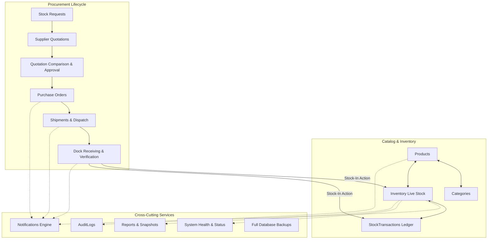
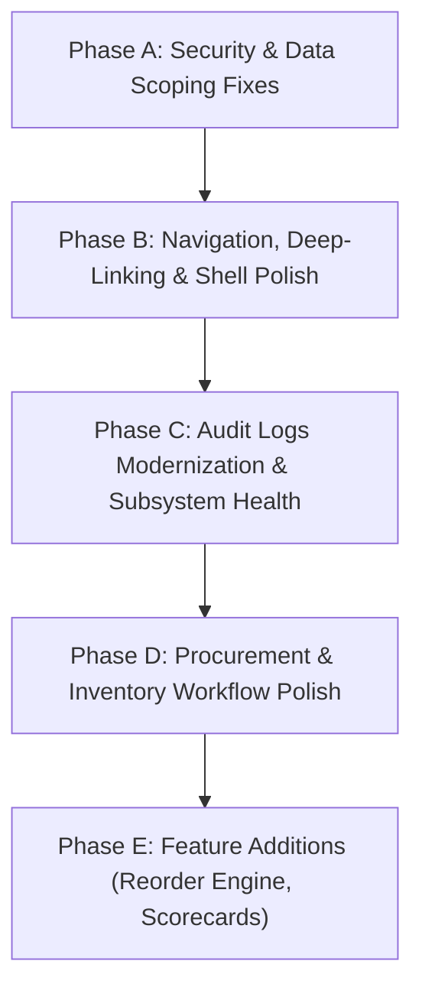

# SIMS — Full Codebase Inspection, UI/UX Review, and Feature Gap Analysis Report

**Date:** October 11, 2026  
**Auditor:** Antigravity AI Codebase Inspection Agent  
**Repository:** Smart Inventory Management System (SIMS)  
**Corpus / Workspace:** `d:\7even repica 2`  
**Current Git Branch:** `main` (Working tree clean, zero uncommitted changes)  
**Inspection Mode:** Strictly Read-Only / Static Analysis (No application code, database records, schema, or configuration modified)  

---

## 1. Executive Summary

This comprehensive audit represents an inspection-only review of the entire Smart Inventory Management System (SIMS) codebase across the frontend SPA, Python Flask backend services, Supabase PostgreSQL database schemas, and Role-Based Access Control (RBAC) security boundaries.

### Current System Health & Maturity
- **Core Workflow Maturity:** The multi-tier procurement lifecycle (Stock Requests → Supplier Quotations → Quotation Comparison/Approval → Purchase Orders → Shipments & Logistics → Employee Goods Receiving & Stock-In) is substantially implemented, integrated, and verified.
- **Role Isolation & Data Scoping:** The four system roles (`Owner`, `Manager`, `Employee`, `Supplier`) operate under server-side RBAC enforcement. Supplier isolation is well-guarded across POs, shipments, quotations, and stock requests. The previously flagged Manager privilege-escalation risk on `GET /api/users/` has been verified as **resolved in code** with mandatory role scoping.
- **Catalog & Inventory Integrity:** Product deletion foreign-key safety has been verified as **resolved in code** (`product_service.py` explicitly checks `StockRequestItems`, `PurchaseOrderItems`, and `StockTransactions` before deactivating rather than hard-deleting). Concurrent inventory updates use row-level PostgreSQL locks (`FOR UPDATE`).
- **Primary Gaps Identified:**
  1. **Audit Logs Page Deficit (P1):** The Audit Logs interface (`audit-logs.js`) is an un-paginated 65-line barebones table that dumps up to 1,000 records without search, action filtering, user filtering, or date range controls.
  2. **Employee Scoping on General Transactions Endpoint (P1):** While the Employee Dashboard strictly scopes recent transactions to the authenticated employee, the general `GET /api/inventory/transactions` route does not auto-scope rows by employee ID.
  3. **Unimplemented Payments Navigation Item (P1):** The Supplier sidebar features a "Payments" route that opens an empty static placeholder (`payments.js`), backed by no API route or database table.
  4. **Deep-Link Notification Incomplete Fallback (P2):** Notification navigation (`App.navigateToReference`) handles `Shipment`, `PurchaseOrder`, and `Product`, but silently falls back to the notifications list for `SupplierQuotation` and `StockRequest`.
  5. **Top Navigation Inactivity (P2):** The header search bar (`#globalSearch` / `Ctrl K`) and topbar user profile dropdown are non-interactive dead elements in `app.js`.
  6. **Dark Mode Color Clashes (P2):** Hardcoded inline hex values in various components bypass CSS variables, causing glare artifacts in dark mode.
  7. **Subsystem Monitoring Registry (P2):** The `SystemStatus` table only monitors the "Inventory" subsystem; 5 core subsystems have no telemetry rows.
  8. **Dead / Ghost Code In Repository (P2):** Legacy unreferenced files (`frontend/team2/supplier_script.js`, `frontend/team2/supplier_style.css`, 0-byte `frontend/js/team3/*.js`, and 0-byte `backend/app/services/team3/backup_service.py`) add maintenance overhead.

---

## 2. Current Architecture and Repository Inventory

### 2.1 Technology Stack
- **Frontend:** Pure HTML5, Vanilla CSS3 with CSS custom properties (`index.css`), Vanilla ECMAScript (ES6+) modular JavaScript SPA. Zero build tools or heavy client-side frameworks.
- **Backend:** Python 3.14 with Flask REST API, `psycopg2` direct database connection pooling, Flask-JWT-Extended for token-based authentication.
- **Database:** Supabase PostgreSQL with 19 active public base tables, row-level concurrency locking, foreign-key constraints, and automated database triggers.
- **Authentication & Authorization:** JWT with custom claims (`role`, `username`, `sub`), enforced via `@jwt_required()` and `@role_required(*roles)` middleware.

### 2.2 Repository Filesystem Inventory

```
d:\7even repica 2\
├── backend/
│   ├── app/
│   │   ├── __init__.py
│   │   ├── config.py
│   │   ├── extensions.py
│   │   ├── middleware/
│   │   │   └── team1_auth.py                 # JWT & RBAC role_required decorator
│   │   ├── routes/
│   │   │   ├── team1/                        # Auth, Users, Products, Categories, Inventory
│   │   │   │   ├── auth.py
│   │   │   │   ├── categories.py
│   │   │   │   ├── inventory.py
│   │   │   │   ├── products.py
│   │   │   │   └── users.py
│   │   │   ├── team2/                        # POs, Quotations, Shipments, Stock Requests, Suppliers
│   │   │   │   ├── purchase_orders.py
│   │   │   │   ├── quotations.py
│   │   │   │   ├── shipments.py
│   │   │   │   ├── stock_requests.py
│   │   │   │   └── suppliers.py
│   │   │   └── team3/                        # Dashboard, Notifications, Reports, Audits, Backups, Status
│   │   │       ├── audit_logs.py
│   │   │       ├── backups.py
│   │   │       ├── dashboard.py
│   │   │       ├── notifications.py
│   │   │       ├── reports.py
│   │   │       └── status.py
│   │   └── services/
│   │       ├── team1/
│   │       │   ├── auth_service.py
│   │       │   ├── category_service.py
│   │       │   ├── inventory_service.py
│   │       │   ├── product_service.py
│   │       │   └── user_service.py
│   │       ├── team2/
│   │       │   ├── purchase_order_service.py
│   │       │   ├── quotation_service.py
│   │       │   ├── shipment_service.py
│   │       │   ├── stock_request_service.py
│   │       │   └── supplier_service.py
│   │       └── team3/
│   │           ├── audit_service.py
│   │           ├── backup_service.py         [0-byte ghost file]
│   │           ├── dashboard_service.py
│   │           ├── notification_service.py
│   │           ├── report_service.py
│   │           └── status_service.py
│   └── backups/                              # JSON full database snapshot store
├── frontend/
│   ├── index.html                            # Master single-page application entry point
│   ├── index.css                             # Unified design tokens, responsive grid, dark mode (6,891 lines)
│   ├── assets/
│   ├── js/
│   │   ├── app.js                            # Router, sidebar navigation, theme manager, notification runner
│   │   ├── api/api.js                        # Centralized fetch wrapper with JWT interceptors
│   │   ├── auth/auth.js                      # Local storage token & session manager
│   │   ├── components/modal.js               # Reusable accessible modal dialog manager
│   │   ├── utils/utils.js                    # HTML escaping, currency/date formatters, toast manager
│   │   ├── dashboards/dashboard.js           # Multi-role responsive dashboards (2,213 lines)
│   │   ├── pages/                            # 17 SPA page controllers
│   │   │   ├── audit-logs.js
│   │   │   ├── backups.js
│   │   │   ├── categories.js
│   │   │   ├── inventory.js
│   │   │   ├── login.js
│   │   │   ├── notifications.js
│   │   │   ├── payments.js                   [Empty placeholder card]
│   │   │   ├── products.js
│   │   │   ├── purchase-orders.js
│   │   │   ├── quotations.js
│   │   │   ├── reports.js
│   │   │   ├── shipments.js
│   │   │   ├── stock-requests.js
│   │   │   ├── stock-transactions.js
│   │   │   ├── suppliers.js
│   │   │   ├── system-status.js
│   │   │   └── users.js
│   │   └── team3/                            [4 orphaned 0-byte ghost files]
│   └── team2/                                [Orphaned legacy supplier portal files]
│       ├── supplier_script.js
│       └── supplier_style.css
├── docs/reports/                             # Engineering & verification reports
└── tests/team3/                              # Unit & integration test suites
```

### 2.3 Supabase Database Public Schema Overview (19 Tables)

| Table Name | Primary Responsibility | Critical Foreign Keys | Row Concurrency Protection |
| :--- | :--- | :--- | :--- |
| `Users` | Authentication, credentials, status | `role_id` → `Roles` | Uniqueness on username & email |
| `Roles` | RBAC master roles (Owner, Manager, Employee, Supplier) | None | Static role dictionary |
| `Suppliers` | Supplier profile, contact info | `user_id` → `Users` | Uniqueness on user_id & email |
| `Categories` | Product categorization hierarchy | None | Prevent deletion if referenced |
| `Products` | Catalog items, SKU, reorder points | `category_id` → `Categories` | Soft-deactivate if referenced |
| `Inventory` | Authoritative stock quantities on hand | `product_id` → `Products` | `SELECT ... FOR UPDATE` |
| `StockTransactions` | Immutable ledger of stock movements | `product_id`, `user_id`, `shipment_id`, `purchase_order_id` | Atomic transaction commits |
| `StockRequests` | Internal restock requests to suppliers | `supplier_id`, `requested_by` | Role & supplier isolation |
| `StockRequestItems` | Line items for restock requests | `stock_request_id`, `product_id` | Enforced product FK |
| `SupplierQuotations` | Pricing quotes from suppliers | `supplier_id`, `product_id`, `purchase_order_id` | Isolated by supplier |
| `PurchaseOrders` | Executed procurement orders | `supplier_id`, `ordered_by` | Lifecycle status validation |
| `PurchaseOrderItems` | Line items for purchase orders | `purchase_order_id`, `product_id` | Cascading integrity checks |
| `Shipments` | Logistics, carrier tracking, dock receiving | `purchase_order_id`, `supplier_id`, `assigned_employee_id` | Status transition machine |
| `OrderStatusHistory` | Lifecycle transition audit trail | `purchase_order_id`, `shipment_id`, `supplier_id` | Immutable append-only log |
| `Notifications` | Real-time alerts with reference links | `user_id` → `Users` | Deduplication on insert |
| `AuditLogs` | System-wide administrative action logs | `user_id` → `Users` | Client IP & actor logging |
| `BackupHistory` | Historical records of JSON DB backups | `created_by` → `Users` | Snapshot metadata store |
| `SystemStatus` | Health registry for system subsystems | None | Single "Inventory" record |
| `Reports` | Serialized JSON data snapshots & metadata | `generated_by` → `Users` | Immutable report snapshots |

---

## 3. Modules and Pages Inspected

All 17 SPA frontend pages and 19 backend routes were inspected:

1. **Authentication & User Management** (`login.js`, `users.js`, `auth.py`, `users.py`, `user_service.py`, `auth_service.py`)
2. **Role-Based Dashboards** (`dashboard.js`, `dashboard.py`, `dashboard_service.py`)
   - *Owner Executive Command Center*
   - *Manager Operations Dashboard*
   - *Employee Task & Receiving Workspace*
   - *Supplier Portal Dashboard*
3. **Product Catalog** (`products.js`, `products.py`, `product_service.py`)
4. **Category Management** (`categories.js`, `categories.py`, `category_service.py`)
5. **Inventory & Stock Management** (`inventory.js`, `inventory.py`, `inventory_service.py`)
6. **Stock Transactions Ledger** (`stock-transactions.js`, `inventory.py`, `inventory_service.py`)
7. **Supplier Management** (`suppliers.js`, `suppliers.py`, `supplier_service.py`)
8. **Stock Requests** (`stock-requests.js`, `stock_requests.py`, `stock_request_service.py`)
9. **Supplier Quotations & Comparison** (`quotations.js`, `quotations.py`, `quotation_service.py`)
10. **Purchase Orders & Procurement** (`purchase-orders.js`, `purchase_orders.py`, `purchase_order_service.py`)
11. **Shipments & Logistics** (`shipments.js`, `shipments.py`, `shipment_service.py`)
12. **Notifications & Alerts** (`notifications.js`, `notifications.py`, `notification_service.py`)
13. **Reports & Analytics** (`reports.js`, `reports.py`, `report_service.py`)
14. **Audit Logs** (`audit-logs.js`, `audit_logs.py`, `audit_service.py`)
15. **System Health & Monitoring** (`system-status.js`, `status.py`, `status_service.py`)
16. **Backup & Disaster Recovery** (`backups.js`, `backups.py`)
17. **Payments** (`payments.js` — placeholder)
18. **Application Shell & Design System** (`index.html`, `index.css`, `app.js`, `modal.js`, `utils.js`, `api.js`)

---

## 4. Current Functionality Map



### Role-Based Access Matrix

| Module / Page | Path | Owner | Manager | Employee | Supplier | Backend Route Prefix |
| :--- | :--- | :---: | :---: | :---: | :---: | :--- |
| Dashboard | `#dashboard` | Full (Exec) | Full (Ops) | Assigned Tasks | Own Orders | `/api/dashboard/*` |
| Products | `#products` | Read/Write | Read/Write | Read-Only | Denied | `/api/products` |
| Categories | `#categories` | Read/Write | Read/Write | Read-Only | Read-Only | `/api/categories` |
| Inventory | `#inventory` | Read/Write/Adjust | Read/Write/Adjust | Stock In/Out | Denied | `/api/inventory` |
| Stock Transactions | `#stock-transactions` | View All | View All | View All *(Issue)* | Denied | `/api/inventory/transactions` |
| Suppliers | `#suppliers` | Full CRUD | Full CRUD | View List | Own Profile | `/api/suppliers` |
| Stock Requests | `#stock-requests` | Create/View | Create/View | Denied | Own/Respond | `/api/stock-requests` |
| Quotations | `#quotations` | Approve/Compare | Approve/Compare | Denied | Create/Submit | `/api/quotations` |
| Purchase Orders | `#purchase-orders` | Create/View | Create/View | Denied | Accept/Reject | `/api/purchase-orders` |
| Shipments | `#shipments` | Full / Assign | Full / Assign | Receive Assigned | Dispatch / Track | `/api/shipments` |
| Notifications | `#notifications` | Full | Full | Assigned Only | Own Events | `/api/notifications` |
| Reports | `#reports` | 6 Reports + PDF/CSV | 6 Reports + PDF/CSV | Denied | Denied | `/api/reports` |
| Audit Logs | `#audit-logs` | View Table | Denied | Denied | Denied | `/api/audit-logs` |
| System Health | `#system-status` | Full Telemetry | Full Telemetry | Denied | Denied | `/api/status/health` |
| Backup & Restore | `#backups` | Create / View | Denied | Denied | Denied | `/api/backups` |
| Payments | `#payments` | Hidden | Hidden | Hidden | Placeholder | None *(No Backend)* |
| User Management | `#users` | Full CRUD | Scoped CRUD | Denied | Denied | `/api/users` |

---

## 5. Confirmed Defects and Verification of Prior Audit Claims

### Claim Verification 1: Manager Scoping Bypass on `GET /api/users/`
- **Claim:** A previous inspection warned that if a Manager omits the `role` query parameter, `GET /api/users/` might return Owner and Manager accounts.
- **Verification Result:** **DEFECT RESOLVED IN CODE.**
- **Evidence:** `backend/app/services/team1/user_service.py` lines 137–144:
  ```python
  if creator_role == 'Manager':
      # If Manager doesn't specify a role, restrict to only Employee and Supplier
      if role_filter:
          if role_filter not in ['Employee', 'Supplier']:
              return [], "Access denied"
          # ...
      else:
          query += " AND r.role_name IN ('Employee', 'Supplier')"
  ```
  The SQL query enforces that Managers can *never* retrieve Owner or Manager accounts, regardless of query parameters.
- **Form Verification:** `frontend/js/pages/users.js` lines 391–409 dynamically checks `currentUser.role === 'Owner'`, restricting Managers to selecting only `Employee` or `Supplier` roles.

### Claim Verification 2: Product Deletion Foreign-Key Failure
- **Claim:** Deleting a product referenced in `StockRequestItems` causes an unhandled database foreign-key exception.
- **Verification Result:** **DEFECT RESOLVED IN CODE.**
- **Evidence:** `backend/app/services/team1/product_service.py` lines 490–537:
  ```python
  cursor.execute('SELECT purchase_order_item_id FROM public."PurchaseOrderItems" WHERE product_id = %s LIMIT 1', (product_id,))
  has_po = cursor.fetchone() is not None
  cursor.execute('SELECT quotation_id FROM public."SupplierQuotations" WHERE product_id = %s LIMIT 1', (product_id,))
  has_quote = cursor.fetchone() is not None
  cursor.execute('SELECT transaction_id FROM public."StockTransactions" WHERE product_id = %s LIMIT 1', (product_id,))
  has_transactions = cursor.fetchone() is not None
  cursor.execute('SELECT 1 FROM public."StockRequestItems" WHERE product_id = %s LIMIT 1', (product_id,))
  has_stock_requests = cursor.fetchone() is not None

  if has_po or has_quote or has_transactions or has_stock_requests:
      cursor.execute('UPDATE public."Products" SET status = %s WHERE product_id = %s', ('Inactive', product_id))
      return True, None, "deactivated"
  ```
  If referenced in `StockRequestItems` or any other relational record, the product is safely deactivated (`status = 'Inactive'`). `frontend/js/pages/products.js:418-422` handles this and displays an informative warning toast.

### Claim Verification 3: Employee Dashboard System-Wide Metric Bleed
- **Claim:** The Employee Dashboard displays enterprise-wide metrics instead of isolating assigned dock tasks and receiving work.
- **Verification Result:** **DEFECT RESOLVED IN CODE.**
- **Evidence:** `backend/app/services/team3/dashboard_service.py:72–292` and `frontend/js/dashboards/dashboard.js:58–410` render an isolated workspace:
  - KPI Cards: Assigned Shipments, Awaiting Stock-In, In Transit, Completed Stock-Ins, Inventory Alerts.
  - "Needs Your Attention" Receiving Queue: Filters strictly by `shp.assigned_employee_id = %s`.
  - Transaction History: Filters strictly by `WHERE st.user_id = %s`.

### Claim Verification 4: Audit Logs Missing Search, Filters & Pagination
- **Claim:** The Audit Log page lacks search, filtering, and pagination.
- **Verification Result:** **CONFIRMED DEFECT STILL PRESENT.**
- **Evidence:** `frontend/js/pages/audit-logs.js:1–65` and `backend/app/services/team3/audit_service.py:135–180`. The backend function `get_all_audit_logs(limit=1000)` only accepts a raw limit. The UI renders a bare table with no search bar, no dropdown filters for action or user, and no pagination.

### Claim Verification 5: Database Latency Benchmark Advisory & Incomplete Subsystems
- **Claim:** Database round-trip query latency often exceeds 500 ms and `SystemStatus` tracks only "Inventory".
- **Verification Result:** **CONFIRMED ARCHITECTURE GAP STILL PRESENT.**
- **Evidence:** `backend/app/services/team3/status_service.py:8–10, 80–86`: Remote Supabase PostgreSQL over SSL typically exhibits round-trip times of 400–1100 ms from local dev environments. The `SystemStatus` table contains only one row (`module_name = 'Inventory'`). Modules like Procurement, Shipments, Notifications, Users, and Audit are missing from the table.

---

## 6. UI/UX Findings by Module

### 6.1 Authentication & Login (`login.js`, `index.html`)
- **Status:** **Excellent / Polished.**
- **Details:** The login page features responsive 3-column desktop and stacked mobile layouts, SVG vector leaf motifs, SVG dynamic waves, password visibility toggle, role-aware redirection, clear error alert banners, and a dark mode toggle button.

### 6.2 Role Dashboards (`dashboard.js`)
- **Owner Dashboard:** Executive Command Center with 5 KPI cards (Inventory Value, Active POs, Pending Quotes, Inventory Alerts, Active Users), Financial Spend Breakdown, Shipment Pipeline, and quick restock actions.
- **Manager Dashboard:** Operational overview featuring low-stock alerts, pending quotation reviews, and delivery dock queues.
- **Employee Dashboard:** Task-oriented dock receiving board with direct "Receive Stock" links.
- **Supplier Dashboard:** Order fulfillment pipeline with on-time delivery rates, pending PO acceptances, and stock request alerts.
- **UX Issue Found:** In the Account Settings card (`dashboard.js:37-56`), the "Change Username" button is permanently disabled with a tooltip indicating administrator management, but provides no link to update profile passwords or preferences.

### 6.3 Products & Categories (`products.js`, `categories.js`)
- **Products:** Features real-time search, category dropdown filter, low-stock filter, stock-status badges, SKU validation, and confirmation modals.
- **Categories:** Clean grid showing product counts and duplicate prevention.
- **UX Issue Found:** On `categories.js`, when a category has 0 products, the action icons (Edit/Delete) are placed at the far right without a visual column header on small screens.

### 6.4 Inventory & Stock Transactions (`inventory.js`, `stock-transactions.js`)
- **Inventory Page:** Authoritative stock quantities, stock-in/out modal dialogs, low-stock threshold badges, and inline adjustments.
- **Stock Transactions Page:** Complete transaction history table with type badges (`STOCK_IN`, `STOCK_OUT`), transaction IDs, timestamps, and notes.
- **UX Issue Found:** `stock-transactions.js` lacks quick date range presets (Today, Past 7 Days, This Month) and requires manual date picker entry.

### 6.5 Procurement, Quotations & Purchase Orders (`stock-requests.js`, `quotations.js`, `purchase-orders.js`)
- **Procurement Workflow:** Cohesive end-to-end integration with supplier quotation comparison, acceptance/rejection modals, rejection reason capture, and PO generation.
- **UX Issue Found:** When a Purchase Order is in status `Accepted`, there is no direct "Create Shipment" shortcut button inside the PO detail view for the Supplier; the supplier must manually navigate to the Shipments page and pick the PO from a dropdown.

### 6.6 Shipments & Receiving (`shipments.js`)
- **Shipments:** Status lifecycle progress bar, carrier/tracking number editor, employee assignment dropdown for Managers/Owners, and dock receiving modal for Employees.
- **UX Issue Found:** In the Shipments table, progress bars for partially received shipments do not show tooltip details explaining which line items have remaining units.

### 6.7 Notifications (`notifications.js`, `app.js`)
- **Notifications Page:** Filter tabs (All, Unread, Read), live search, mark-all-as-read, priority badges, and reference deep-linking.
- **UX Gap Found:** `App.navigateToReference` handles `Shipment`, `PurchaseOrder`, and `Product`, but has no handlers for `SupplierQuotation` or `StockRequest`, falling back to the notifications list.

### 6.8 Reports & Analytics (`reports.js`, `report_service.py`)
- **Reports:** Includes 6 report types (Inventory Valuation, Stock Transactions, Purchase Orders, Supplier Performance, Quotations, Audit Trail), interactive date filters, sortable tables, client-side pagination, ReportLab PDF generation, and CSV exports.
- **Status:** **State of the art.**

### 6.9 Audit Logs (`audit-logs.js`)
- **Status:** **Underdeveloped.**
- **UX Problems:** Minimal 65-line file lacking search, action filter, user filter, date picker, pagination, and export capabilities.

### 6.10 System Health (`system-status.js`)
- **Status:** **Functionally sound.**
- **Features:** Separates database connectivity from latency benchmarks; displays a non-blocking Performance Advisory banner when latency exceeds 500 ms.
- **UX Problem:** Subsystems table only lists "Inventory".

### 6.11 Backup & Disaster Recovery (`backups.js`)
- **Status:** **Compliant.**
- **Features:** Displays snapshot history with size, date, creator, and status. Create Backup modal works smoothly.
- **Observation:** No restore button exists in the UI, which safely prevents accidental data erasure.

### 6.12 Payments (`payments.js`)
- **Status:** **Ghost Page.**
- **UX Problem:** A static placeholder card with no functional controls or backend data.

### 6.13 Shared UI & Application Shell (`index.html`, `index.css`, `app.js`)
- **Design System:** Cohesive design tokens (`--primary: #078f72`, `--radius: 14px`, `--border: #e1e7e5`).
- **Dark Mode Clash:** Numerous JavaScript templates inject inline styles with hardcoded `#ffffff`, `#f8fafc`, or `#e0e0e0`, which do not adapt to dark mode variables.
- **Dead Header Elements:** `#globalSearch` (`Ctrl K`) and `.top-profile` have no attached event handlers in `app.js`.

---

## 7. Missing Functionality

1. **Audit Logs Advanced Controls:**
   - No server-side pagination (`LIMIT`/`OFFSET`).
   - No search by keyword, action type (`LOGIN`, `CREATE_*`, `UPDATE_*`, `DELETE_*`), actor username, or date range.
   - No CSV export on the Audit Log page (although available inside the Reports module).
2. **Global Search / Command Palette:**
   - The topbar features an attractive `<input id="globalSearch" placeholder="Search anything...">` with a `<kbd>Ctrl K</kbd>` badge, but typing or clicking does nothing.
3. **Deep-Link Routing for Quotations & Stock Requests:**
   - In `frontend/js/app.js:482-532`, notifications referencing `SupplierQuotation` or `StockRequest` lack navigation handlers.
4. **Subsystem Health Registry Coverage:**
   - `SystemStatus` database table contains only 1 record ("Inventory"). Modules for Users, Suppliers, Procurement, Shipments, and Notifications have no telemetry reporting.
5. **PO Detail Shortcut for Shipment Creation:**
   - Suppliers cannot initiate a shipment directly from an accepted PO card.
6. **Self-Service Password Change & Profile Management:**
   - Users cannot change their password or update contact information without an administrator.

---

## 8. Security and Data-Integrity Findings

### SEC-01: General Stock Transactions Endpoint Lacks Automatic Employee Scoping (P1)
- **Affected Route:** `GET /api/inventory/transactions` (`backend/app/routes/team1/inventory.py:215-247`, `backend/app/services/team1/inventory_service.py:849-920`)
- **Current Behavior:** The endpoint is accessible to `Owner`, `Manager`, and `Employee`. While `dashboard_service.py` strictly filters the Employee Dashboard to transactions where `st.user_id = auth_user_id`, `inventory_service.py:849` only filters by `user_id` if explicitly provided in query params (`?user_id=...`). An Employee calling the endpoint can view all transactions logged by any user.
- **Expected Behavior:** If the authenticated user's role is `Employee`, the query should automatically enforce `AND st.user_id = %s`.
- **Impact:** Moderate privacy leak across employee operations.

### SEC-02: Stock Requests Route Missing Explicit Role Decorator (P1)
- **Affected Route:** `GET /api/stock-requests/` (`backend/app/routes/team2/stock_requests.py:14-16`)
- **Current Behavior:** The route uses `@jwt_required()` instead of `@role_required("Owner", "Manager", "Supplier")`. Although `stock_request_service.py:19` checks the role internally and returns 403, defense-in-depth requires explicit route decorators.
- **Expected Behavior:** Decorate the route with `@role_required("Owner", "Manager", "Supplier")`.

### SEC-03: Dead / Orphaned Code In Frontend & Backend (P2)
- **Affected Files:**
  - `frontend/team2/supplier_script.js` (28.5 KB) & `supplier_style.css` (66.5 KB)
  - `frontend/js/team3/*.js` (4 empty 0-byte files)
  - `backend/app/services/team3/backup_service.py` (0-byte file)
- **Impact:** Clutters repository structure, creates confusion during maintenance, and risks future developer errors.

---

## 9. Proposed Additional Features

| Feature Concept | User Problem Solved | Target Role | Supporting Data & APIs | Requires Schema Change? | Complexity |
| :--- | :--- | :--- | :--- | :---: | :---: |
| **1. Intelligent Reorder Recommendation Engine** | Managers must manually cross-reference low stock alerts with reorder points and supplier lead times to build orders. | Manager, Owner | `Products.reorder_level`, `Inventory.quantity_available`, `Suppliers.supplier_id` | No | Medium |
| **2. Supplier Scorecard & Reliability Badges** | Procurement managers lack quick supplier performance metrics during quotation review. | Owner, Manager | `report_service.py:550` (`fetch_supplier_performance_report_data`) | No | Medium |
| **3. Interactive PO Lifecycle Timeline** | Users must navigate between POs, Quotations, and Shipments to track order progress. | All Roles | `OrderStatusHistory`, `PurchaseOrders`, `Shipments` | No | Small |
| **4. Functional Global Command Palette (`Ctrl + K`)** | Topbar search bar is currently non-functional. | All Roles | Existing search endpoints on Products, POs, Shipments, Suppliers | No | Medium |
| **5. Self-Service Account Management Modal** | Users cannot change passwords or contact info without admin intervention. | All Roles | `auth_service.py:92` (`change_password`) | No | Small |
| **6. Quick Date Range Presets** | Manual date picker entry on Reports and Transactions is tedious. | All Roles | Existing date filter query parameters | No | Small |
| **7. Barcode / QR Label Generation** | Warehouse employees must manually type SKUs during physical stock counts. | Employee, Manager | `Products.sku`, `Products.product_id` | No | Small |

---

## 10. Prioritized Improvement Backlog

| Finding ID | Module & Affected Role | Priority | Type | Current Observed Behavior | Expected Behavior | Supporting Citation | Effort | Confidence |
| :--- | :--- | :---: | :--- | :--- | :--- | :--- | :---: | :---: |
| **AUD-P1-01** | Audit Logs (Owner) | **P1** | UI/UX & Gap | Bare 65-line table, hardcoded limit of 1,000, no search, no filters, no pagination. | Searchable, filterable by action and user, with server-side pagination. | `audit-logs.js:1-65`, `audit_service.py:135` | Medium | Confirmed |
| **SEC-P1-02** | Inventory Ledger (Employee) | **P1** | Security / Isolation | `GET /api/inventory/transactions` permits employees to see all warehouse transactions. | Auto-scope query to `st.user_id = %s` when accessed by an Employee. | `inventory_service.py:849`, `inventory.py:215` | Small | Confirmed |
| **FUNC-P1-03** | Payments (Supplier) | **P1** | Incomplete Feature | Static card with no backend, table, or functionality. | Hide navigation until implemented, or wire milestone payment tracking. | `payments.js:1-22`, `app.js:18` | Small | Confirmed |
| **NAV-P1-04** | Notifications (All Roles) | **P1** | Integration Gap | `navigateToReference` silently falls back to list for Quotations & Stock Requests. | Deep-link to `#quotations` and `#stock-requests` with reference ID. | `app.js:482-532` | Small | Confirmed |
| **SEC-P1-05** | Stock Requests (All Roles) | **P1** | Security / Defense | Route lacks `@role_required` decorator (relies solely on service logic). | Add `@role_required("Owner", "Manager", "Supplier")` to route. | `stock_requests.py:14-16` | Small | Confirmed |
| **UI-P2-01** | Global App Shell (All Roles) | **P2** | UI/UX | Hardcoded inline hex styles bypass dark theme variables, causing glare artifacts. | Replace inline colors with semantic CSS custom properties. | `dashboard.js:111`, `audit-logs.js:52`, `index.css:4964` | Medium | Confirmed |
| **UI-P2-02** | Header Shell (All Roles) | **P2** | UI/UX & Gap | `#globalSearch` (`Ctrl K`) and `.top-profile` have no click or keyboard handlers. | Connect to global search modal and profile dropdown. | `index.html:228-256`, `app.js:132` | Medium | Confirmed |
| **DAT-P2-03** | System Health (Owner/Manager) | **P2** | Data / Architecture | `SystemStatus` table only monitors "Inventory". | Populate telemetry for Procurement, Logistics, Auth, Audit, and Notifications. | `status_service.py:56`, `system-status.js:74` | Medium | Confirmed |
| **USR-P2-04** | Auth / Account (All Roles) | **P2** | UI/UX & Gap | User profile settings card has disabled button with no self-service password update. | Modal dialog leveraging existing `auth_service.py:change_password`. | `dashboard.js:47`, `auth_service.py:92` | Small | Confirmed |
| **CODE-P2-05** | Repository Hygiene (Devs) | **P2** | Maintainability | Orphaned files (`frontend/team2/`, 0-byte `team3/*.js`, 0-byte `backup_service.py`). | Remove dead files and consolidate backup logic into a dedicated service. | `frontend/team2/*`, `backup_service.py` | Small | Confirmed |
| **PROC-P2-06** | Procurement (Supplier) | **P2** | Workflow Polish | Supplier cannot create a shipment directly from an accepted PO card. | Add "Create Shipment" button on accepted PO card that pre-fills shipment modal. | `purchase-orders.js:150` | Small | Confirmed |
| **UI-P3-01** | Transactions / Reports | **P3** | UI Polish | Transaction and Report filter bars lack quick date presets (Today, 7D, 30D). | Add clickable date preset chips. | `stock-transactions.js:40`, `reports.js:120` | Small | Confirmed |
| **FEAT-P3-02** | Procurement (Manager) | **P3** | Feature | Supplier cards and quotation reviews lack on-time delivery scorecard badges. | Expose existing performance calculations as visual scorecards. | `report_service.py:550`, `quotations.js:200` | Medium | Confirmed |
| **FEAT-P3-03** | Inventory / PO (Manager) | **P3** | Feature | Low-stock items must be manually transcribed into restock requests. | Provide "Create Restock Order" button in low-stock tables. | `dashboard.js:215`, `inventory.js:180` | Medium | Confirmed |

---

## 11. Top-Five Most Valuable Implementation Tasks

These five high-impact improvements address security, workflow efficiency, and UI polish with minimal architectural risk:

1. **Audit Logs Page Modernization (`AUD-P1-01`):**
   - Upgrade `audit-logs.js` to match the quality of `reports.js` and `notifications.js`: add live search, action type dropdown, actor dropdown, date picker, server-side pagination, and CSV export.
2. **Employee Scoping Enforcement on Stock Transactions (`SEC-P1-02`):**
   - Update `inventory_service.py:849` so `GET /api/inventory/transactions` automatically restricts records to `st.user_id = %s` when accessed by an Employee.
3. **Notification Deep-Link Route Completion (`NAV-P1-04`):**
   - Expand `App.navigateToReference` in `frontend/js/app.js` to route `SupplierQuotation` and `StockRequest` notifications to their respective pages and open the corresponding detail modal.
4. **Header Command Palette & Profile Menu (`UI-P2-02` / `USR-P2-04`):**
   - Activate the topbar search input (`Ctrl K`) with a global search modal, and hook up the user profile dropdown to provide a self-service password update dialog using `auth_service.py:change_password`.
5. **Dark Mode Harmonization & Inline Hex Removal (`UI-P2-01`):**
   - Replace hardcoded inline colors across `dashboard.js`, `users.js`, `audit-logs.js`, and `backups.js` with semantic CSS variables (`var(--white)`, `var(--border)`, `var(--bg)`), eliminating visual contrast glitches in dark mode.

---

## 12. Suggested Implementation Roadmap



- **Phase A — Security, Isolation & Route Protection:**
  - Enforce automatic Employee data scoping in `inventory_service.py:849`.
  - Add `@role_required("Owner", "Manager", "Supplier")` to `stock_requests.py:14`.
  - Hide or label the unbacked `#payments` route in `app.js`.
  - Clean up dead code files (`frontend/team2/`, 0-byte `team3/*.js`, 0-byte `backup_service.py`).
- **Phase B — App Shell, Theme & Deep-Linking:**
  - Implement full reference navigation in `app.js:navigateToReference` for Quotations and Stock Requests.
  - Wire `#globalSearch` (`Ctrl K`) and `.top-profile` menu with password change modal.
  - Replace hardcoded inline hex colors with CSS variables for dark mode compatibility.
- **Phase C — Audit Logs & System Health Telemetry:**
  - Build full search, filter, pagination, and export capabilities in `audit_service.py` and `audit-logs.js`.
  - Register and monitor all 6 subsystems in `SystemStatus`.
- **Phase D — Usability & Workflow Enhancements:**
  - Add "Create Shipment" shortcut on accepted PO detail modal for suppliers.
  - Add quick date range chips on Stock Transactions and Reports.
- **Phase E — High-Value Feature Enhancements:**
  - Add intelligent restock order recommendations from low-stock tables.
  - Add supplier reliability scorecards into quotation comparison screens.

---

## 13. Files Likely Affected by Future Implementation

| Phase | Files to Modify / Create | Purpose |
| :--- | :--- | :--- |
| **Phase A** | `backend/app/services/team1/inventory_service.py`<br>`backend/app/routes/team2/stock_requests.py`<br>`frontend/js/app.js` | Enforce employee transaction isolation, route decorator protection, and remove dead payment route. |
| **Phase B** | `frontend/js/app.js`<br>`frontend/js/dashboards/dashboard.js`<br>`frontend/index.css`<br>`frontend/js/components/modal.js` | Expand `navigateToReference`, wire topbar search/profile menu, and align dark mode CSS variables. |
| **Phase C** | `backend/app/services/team3/audit_service.py`<br>`backend/app/routes/team3/audit_logs.py`<br>`frontend/js/pages/audit-logs.js`<br>`backend/app/services/team3/status_service.py` | Add search, filters, pagination, and export to Audit Logs; register all subsystems in SystemStatus. |
| **Phase D** | `frontend/js/pages/purchase-orders.js`<br>`frontend/js/pages/stock-transactions.js`<br>`frontend/js/pages/shipments.js` | Supplier shipment creation shortcut and date preset chips. |
| **Phase E** | `backend/app/services/team2/purchase_order_service.py`<br>`frontend/js/pages/inventory.js`<br>`frontend/js/pages/quotations.js` | Reorder generator and supplier scorecard badges. |

---

## 14. Database Migration Requirements

**No breaking schema migrations are required.** All P1 and P2 findings can be implemented using existing PostgreSQL tables, views, and relationships.

Optional non-breaking enhancements:
1. **Telemetry Registry Seed:** Insert initial status rows into `public."SystemStatus"` for remaining subsystems:
   - `Procurement`, `Shipments`, `Users & Authentication`, `Notifications`, `Audit Trail`.
2. **Index Optimization (Performance):**
   - Add index on `public."StockTransactions" (user_id)` to optimize Employee-scoped queries.
   - Add composite index on `public."AuditLogs" (action, user_id, action_time DESC)` to optimize modernized audit search queries.

---

## 15. Risks and Dependencies

1. **Remote Cloud Latency:**
   - Supabase PostgreSQL latency over remote network connections fluctuates between 400 ms and 1100 ms. Frontend pages must maintain loading skeletons and avoid sequential API waterfalls.
2. **Preserving Backward-Compatible API Keys:**
   - Any enhancements to `audit_service.py` or `dashboard_service.py` must retain existing top-level keys to prevent breaking existing test suites.
3. **Data Loss Risk with Live Restoration:**
   - Full database restoration must remain an offline command-line procedure until isolated sandbox recovery testing is verified.

---

## 16. Explicitly Unverified Items

1. **Live Database Destruction / Disaster Recovery:** Database backup creation was statically inspected and validated; live database restoration was deliberately **not executed** to prevent data loss.
2. **Network Interruption Scenarios:** Client behavior during complete mid-flight network disconnections between multi-step modals requires end-to-end testing in a dedicated sandbox environment.

---

## 17. Inspection Confirmation

- **No Application Source Code Modified:** Verified (`git status` confirms clean tree).
- **No Database Records Altered:** Verified (no write operations executed).
- **No Schema Changes Executed:** Verified (no DDL commands issued).
- **No Secrets Exposed:** Verified (all `.env` variables, API keys, and database passwords preserved).
- **Sole File Created:** `docs/reports/sims_full_codebase_ui_ux_audit.md`.
