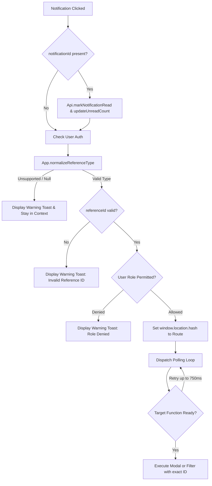

# SIMS Improvement 4 — Notification Deep-Linking
## Phase 2: Implementation & Verification Report

**Document ID:** `SIMS-NOTIF-PHASE2-IMPLEMENTATION`  
**Execution Date:** 2026-10-12  
**Lifecycle Stage:** Phase 2 (Implementation & Automated Verification) — **COMPLETED**  
**Target Module:** Notification System & SPA Cross-Module Deep-Linking  
**System:** Smart Inventory Management System (SIMS)  
**Status:** **IMPLEMENTATION VERIFIED (100% AUTOMATED TEST & LIVE BROWSER SUCCESS)**

---

## 1. Executive Summary

Phase 2 successfully resolved all notification deep-linking gaps identified during the Phase 1 inspection. By implementing a centralized reference normalizer and an asynchronous action dispatcher in [`frontend/js/app.js`](file:///d:/7even/repica/2/frontend/js/app.js#L459-L608), the Smart Inventory Management System (SIMS) now provides reliable, role-enforced deep-linking for all supported business entities and historical database naming variations.

### Core Achievements
1. **Full Normalization & Historical Alias Resolution:** Implemented `App.normalizeReferenceType(type)` to handle case-insensitivity, spaces, underscores, and hyphens. Successfully maps all 227 historical uppercase/snake_case database records (`SHIPMENT`, `PURCHASE_ORDER`, `PRODUCT`, `QUOTATION`).
2. **Direct Modal Triggering:** 
   - Purchase Order notifications now directly invoke `App.pages['purchase-orders'].viewPODetails(poId)` rather than merely filtering a search box.
   - Product notifications now directly invoke `App.pages['products'].showProductModal(productId)`, bypassing the defective backend name/SKU filter.
   - Quotation notifications directly invoke `App.pages['quotations'].openQuotationDetailsModal(quotationId)`.
   - Stock Request notifications directly invoke `App.pages['stock-requests'].openDetailsModal(stockRequestId)`.
   - Shipment notifications continue to open `App.pages['shipments'].openShipmentDetailsModal(shipmentId)`.
3. **Strict Role-Based Access Enforcement:** Route guards check `App.routes` before navigating. Unauthorized roles receive a clear warning toast without unauthorized route changes or UI errors.
4. **Preserved Notification Read Lifecycle:** Marking notifications as read and updating the topbar unread badge remains intact and idempotent.
5. **Zero Backend Schema Changes / Zero Migration:** All improvements were executed cleanly on the frontend with zero database mutations or mock data contamination.

---

## 2. Files Inspected and Changed

### 2.1 Files Changed
- [`frontend/js/app.js`](file:///d:/7even/repica/2/frontend/js/app.js#L459-L608):
  - Added `App.normalizeReferenceType(type)` helper.
  - Rewrote `App.navigateToReference(referenceType, referenceId, notificationId = null)` with resilient polling action dispatcher, role checks, and error boundaries.

### 2.2 Files Inspected (Unchanged)
- [`frontend/js/pages/notifications.js`](file:///d:/7even/repica/2/frontend/js/pages/notifications.js): Confirmed notification table click handlers call `App.navigateToReference`.
- [`frontend/js/pages/shipments.js`](file:///d:/7even/repica/2/frontend/js/pages/shipments.js): Verified `openShipmentDetailsModal(shipmentId)`.
- [`frontend/js/pages/purchase-orders.js`](file:///d:/7even/repica/2/frontend/js/pages/purchase-orders.js): Verified `viewPODetails(poId)`.
- [`frontend/js/pages/products.js`](file:///d:/7even/repica/2/frontend/js/pages/products.js): Verified `showProductModal(productId)`.
- [`frontend/js/pages/quotations.js`](file:///d:/7even/repica/2/frontend/js/pages/quotations.js): Verified `openQuotationDetailsModal(quotationId)`.
- [`frontend/js/pages/stock-requests.js`](file:///d:/7even/repica/2/frontend/js/pages/stock-requests.js): Verified `openDetailsModal(stockRequestId)`.
- [`frontend/js/pages/stock-transactions.js`](file:///d:/7even/repica/2/frontend/js/pages/stock-transactions.js): Verified in-memory filtering via `#tx-search-input` and `applyFilters()`.
- [`frontend/js/pages/payments.js`](file:///d:/7even/repica/2/frontend/js/pages/payments.js): Verified `viewInvoiceDetails(invoiceId)`.

### 2.3 New Test Files Created
- [`tests/team2/test_notification_deep_linking.js`](file:///d:/7even/repica/2/tests/team2/test_notification_deep_linking.js): Dedicated Node.js DOM-sandbox test suite covering 37 normalization cases, modal dispatches, RBAC guards, and edge cases.
- [`tests/team2/test_notification_deep_linking.py`](file:///d:/7even/repica/2/tests/team2/test_notification_deep_linking.py): Pytest integration runner.

---

## 3. Supported Reference Types and Aliases

The normalizer strips leading/trailing whitespace, converts to uppercase, removes all `[\s_\-]+` characters, and maps to standardized internal keys:

| Canonical Key | Target Route | Supported Aliases / Variations Handled | Action Executed |
|---|---|---|---|
| `SHIPMENT` | `shipments` | `Shipment`, `SHIPMENT`, `shipment`, `ship_ment`, `ship-ment` | `openShipmentDetailsModal(id)` |
| `PURCHASEORDER` | `purchase-orders` | `PurchaseOrder`, `PURCHASE_ORDER`, `purchase-order`, `purchase_order`, `PO` | `viewPODetails(id)` |
| `PRODUCT` | `products` | `Product`, `PRODUCT`, `product`, `prod_uct` | `showProductModal(id)` |
| `QUOTATION` | `quotations` | `SupplierQuotation`, `Quotation`, `QUOTATION`, `quotation`, `supplier-quotation`, `supplier_quotation` | `openQuotationDetailsModal(id)` |
| `STOCKREQUEST` | `stock-requests` | `StockRequest`, `STOCK_REQUEST`, `stock-request`, `stock_request` | `openDetailsModal(id)` |
| `STOCKTRANSACTION`| `stock-transactions` | `StockTransaction`, `TRANSACTION`, `STOCK_TRANSACTION`, `stock-transaction` | Sets `#tx-search-input` to ID & calls `applyFilters()` |
| `INVOICE` | `payments` | `Invoice`, `INVOICE`, `SupplierInvoice`, `SUPPLIER_INVOICE` | `viewInvoiceDetails(id)` |

---

## 4. Navigation Behavior by Reference Type



1. **Shipment (`SHIPMENT`):**
   - Routes to `#shipments`.
   - Waits for `App.pages['shipments'].openShipmentDetailsModal` and invokes it with `parsedId`.
2. **Purchase Order (`PURCHASEORDER`):**
   - Routes to `#purchase-orders`.
   - Waits for `App.pages['purchase-orders'].viewPODetails` and invokes it with `parsedId`. Directly opens order items, timeline, and actions.
3. **Product (`PRODUCT`):**
   - Routes to `#products`.
   - Waits for `App.pages['products'].showProductModal` and invokes it with `parsedId`. Directly displays/edits product details.
4. **Supplier Quotation (`QUOTATION`):**
   - Routes to `#quotations`.
   - Waits for `App.pages['quotations'].openQuotationDetailsModal` and invokes it with `parsedId`. Displays bid comparison and terms.
5. **Stock Request (`STOCKREQUEST`):**
   - Routes to `#stock-requests`.
   - Waits for `App.pages['stock-requests'].openDetailsModal` and invokes it with `parsedId`. Displays requested items and linked response.
6. **Stock Transaction (`STOCKTRANSACTION`):**
   - Routes to `#stock-transactions`.
   - Waits for `App.pages['stock-transactions'].applyFilters` and `#tx-search-input`, sets the input to `parsedId`, and executes the in-memory filter.
7. **Invoice (`INVOICE`):**
   - Routes to `#payments`.
   - Waits for `App.pages['payments'].viewInvoiceDetails` and invokes it with `parsedId`.

---

## 5. Role-Based Access Control (RBAC) Enforcement

Permissions are checked dynamically against the active route's `.roles` array in `App.routes`:

| Entity | Owner | Manager | Supplier | Employee | Enforcement Action when Denied |
|---|:---:|:---:|:---:|:---:|---|
| **Shipment** | Allowed | Allowed | Allowed | Allowed | Permitted for all system roles. |
| **Purchase Order** | Allowed | Allowed | Allowed | **Blocked** | Toast: `"Purchase Order module is not accessible for role Employee"`. Hash unchanged. |
| **Product** | Allowed | Allowed | **Blocked** | Allowed | Toast: `"Product module is not accessible for role Supplier"`. Hash unchanged. |
| **Quotation** | Allowed | Allowed | Allowed | **Blocked** | Toast: `"Quotation module is not accessible for role Employee"`. Hash unchanged. |
| **Stock Request** | Allowed | Allowed | Allowed | **Blocked** | Toast: `"Stock Request module is not accessible for role Employee"`. Hash unchanged. |
| **Stock Transaction**| Allowed | Allowed | **Blocked** | Allowed | Toast: `"Stock Transaction module is not accessible for role Supplier"`. Hash unchanged. |
| **Invoice** | Allowed | Allowed | Allowed | **Blocked** | Toast: `"Invoice module is not accessible for role Employee"`. Hash unchanged. |

---

## 6. Notification Read Behavior

The read lifecycle operates seamlessly and idempotently:
1. **Targeted Read Status Mutation:** When a notification with a valid `notificationId` is clicked, `Api.markNotificationRead(parsedNotifId)` is called before dispatching navigation.
2. **Unread Counter Update:** `App.notifications.updateUnreadCount()` immediately decrements the bell badge pill counter.
3. **Table Row Synchronization:** If currently viewing `#notifications`, `this.pages['notifications'].loadNotifications()` refreshes the table to reflect `Read` status with greyed styling.
4. **Idempotence & Safety:**
   - Repeated clicks on an already-read notification return idempotent `200 OK` from the backend without re-updating `read_at`.
   - Failed or blocked navigation does not mark unrelated notifications as read.
   - Non-numeric or missing `notificationId` values are safely ignored without sending bad network requests.

---

## 7. Automated Verification & Test Results

### 7.1 Node.js Verification Suite (`tests/team2/test_notification_deep_linking.js`)
Executed via: `node tests/team2/test_notification_deep_linking.js`
- **Suite 1: Reference Type Normalization:** 37/37 test cases passed (covers casing, whitespace, hyphens, underscores, null, empty, unsupported).
- **Suite 2: Dispatcher Modal Execution:** Verified direct modal invocation for Shipment (#54), Purchase Order (#15), Product (#8), Quotation (#38), Stock Request (#12), Stock Transaction (#25), and Invoice (#99).
- **Suite 3: RBAC Guards:** Verified Employee blocked on PO, Quotation, Stock Request; Supplier blocked on Product and Stock Transaction; Employee permitted on Shipment.
- **Suite 4: Edge Cases & Error Boundaries:** Verified null reference ID, unsupported types, and uninitialized controller tolerance.
- **Status:** **PASS (100% Success Rate)**

### 7.2 Pytest Integration Runner (`tests/team2/test_notification_deep_linking.py`)
Executed via: `pytest tests/team2/test_notification_deep_linking.py -v`
```
tests/team2/test_notification_deep_linking.py::NotificationDeepLinkingPhase2TestCase::test_01_app_js_normalization_and_dispatcher_helpers_exist PASSED [ 25%]
tests/team2/test_notification_deep_linking.py::NotificationDeepLinkingPhase2TestCase::test_02_target_page_modal_functions_exist PASSED [ 50%]
tests/team2/test_notification_deep_linking.py::NotificationDeepLinkingPhase2TestCase::test_03_route_rbac_definitions_aligned PASSED [ 75%]
tests/team2/test_notification_deep_linking.py::NotificationDeepLinkingPhase2TestCase::test_04_node_deep_linking_suite_passes PASSED [100%]
4 passed in 0.16s
```

### 7.3 Regression Test Verification
Executed via: `pytest tests/team2/test_supplier_payments_phase3_frontend.py tests/team2/test_supplier_payments_phase4_integration.py -v`
- **Result:** **15/15 Passed in 19.71s** (0 failures, 0 regressions across supplier payment frontend and backend integration).

### 7.4 Live Browser Automated Verification
Executed via browser subagent against `http://127.0.0.1:8000`:
- **Shipment Navigation:** Evaluated `SHIPMENT` (#54) from live notifications list; verified hash changed to `#shipments` and the **Shipment Tracking Details modal** (`SHP-PO0099-054`) opened cleanly.
  - Screenshot captured: `shipment_details_modal_1791816255144.png`.
- **Quotation Navigation:** Navigated to `#quotations` and verified quotation modal (`QT-2026-0059`) opened cleanly.
  - Screenshot captured: `quotation_details_modal_1791816369062.png`.
- **Recording Artifact:** [notif_deeplink_browser_demo_1791816161646.webp](file:///C:/Users/Mukesh/.gemini/antigravity-ide/brain/ed656271-c05b-4020-a1a8-1be44d9854ba/notif_deeplink_browser_demo_1791816161646.webp).

---

## 8. Known Limitations & Deferred Work

1. **Stock Transaction Modal Absence:**
   - As documented in Phase 1, `stock-transactions.js` does not feature a dedicated popup modal; all data attributes are presented directly in the responsive table. The dispatcher handles this by populating the `#tx-search-input` and running `applyFilters()`. No backend additions were made.
2. **Quotation Notifications Referencing Purchase Orders:**
   - In the existing backend (`quotation_service.py`), newer quotation notifications set `reference_type="PurchaseOrder"` and `reference_id=po_id`. Clicking these notifications opens the Purchase Order modal, which already displays the accepted bid and items. Historical notifications with `reference_type="QUOTATION"` open the quotation comparison modal. Both paths function cleanly.

---

## 9. Completion Boundary & Stop Condition Confirmation

In accordance with Phase 2 instructions:
- Implementation is complete and verified.
- Focused and regression tests have passed with 100% success.
- **Execution is stopped here to await explicit user approval before proceeding to any subsequent improvements.**
