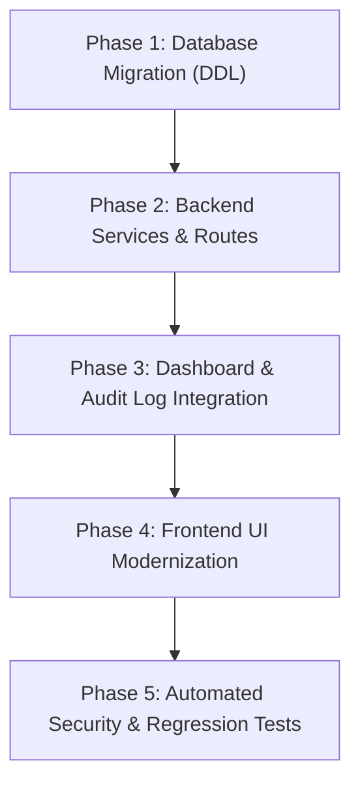

# SIMS — Supplier Payments and Invoice Feature Assessment Report

**Date:** October 11, 2026  
**Type:** Read-Only Technical Assessment & Feasibility Inspection  
**Module:** Supplier Portal & Finance / Procurement Module  
**Feature:** Supplier Invoices & Payment Tracking  
**Status:** Completed (Assessment Only — Zero Code or Schema Changes Made)  

---

## 1. Executive Summary & Current Implementation Status

A comprehensive, read-only architectural inspection of the Smart Inventory Management System (SIMS) was performed to assess the current state of supplier payments and invoice functionality, evaluate existing infrastructure, and determine the optimal implementation strategy.

### Key Assessment Findings:
1. **The Payments Page is a Complete Static Placeholder:**
   - [`frontend/js/pages/payments.js`](file:///d:/7even%20repica%202/frontend/js/pages/payments.js) consists of 22 lines of hardcoded HTML rendering an empty card (*"No Recent Transactions — Your financial records will appear here"*).
   - It performs zero API requests, possesses zero event listeners, has no tables, forms, modals, or action buttons, and is disconnected from the backend.
2. **Inverted Frontend Navigation Role Configuration:**
   - In [`frontend/js/app.js`](file:///d:/7even%20repica%202/frontend/js/app.js) line 18, the route `{ path: 'payments', roles: ['Supplier'] }` restricts the Payments link solely to the `Supplier` role. `Owner` and `Manager` roles cannot even see the Payments navigation link in the sidebar, despite being the organizational authorities responsible for verifying and issuing payments.
3. **Database Lacks Invoice and Payment Tables:**
   - Inspection of the live Supabase PostgreSQL database revealed that tables `"Invoices"` and `"Payments"` **do not exist**.
   - No existing table (`PurchaseOrders`, `PurchaseOrderItems`, `Shipments`, `Suppliers`, `StockRequests`) contains columns for invoice numbers, due dates, payment status, paid amounts, payment methods, or outstanding balances.
4. **Backend Confirms Absence of Payment Module:**
   - In [`backend/app/services/team3/dashboard_service.py`](file:///d:/7even%20repica%202/backend/app/services/team3/dashboard_service.py) (lines 389–391), the backend explicitly hardcodes:
     ```python
     # Note: Database does not have a Payments/Invoices table yet. We explicitly report this.
     pending_payments = None
     has_payment_module = False
     ```
   - Zero API endpoints, routes, models, or service functions exist in the backend for invoices or payments.
5. **Procurement Workflow Lifecycle Truncation:**
   - The current procurement workflow stops after goods receipt:  
     `Stock Request -> Supplier Quotation -> Purchase Order -> Shipment -> Goods Receipt / Stock-In`.  
     The financial closing loop (invoicing, three-way matching, disbursement recording, and settlement) is completely absent.

---

## 2. Relevant Files, API Routes, Services, and Existing Tables

### 2.1 Frontend Files
| File Path | Nature / Role | Current State |
| :--- | :--- | :--- |
| [`frontend/js/pages/payments.js`](file:///d:/7even%20repica%202/frontend/js/pages/payments.js) | Payments Page Component | 22-line static placeholder with no API connectivity or UI controls. |
| [`frontend/js/app.js`](file:///d:/7even%20repica%202/frontend/js/app.js) | Sidebar Navigation & Routing | Line 18 defines `{ path: 'payments', icon: 'bx-money', label: 'Payments', roles: ['Supplier'] }`. |
| [`frontend/js/dashboards/dashboard.js`](file:///d:/7even%20repica%202/frontend/js/dashboards/dashboard.js) | Supplier Dashboard | Lines 626–629 & 1020–1033 show a *"Pending Payments"* KPI card hardcoded with *"— Not tracked (Financial tracking is managed outside this portal)"*. |
| [`frontend/index.css`](file:///d:/7even%20repica%202/frontend/index.css) | Global Stylesheet | Contains dormant utility classes (`.payment-summary`, `.payment-box`, `.payment-alert`) that are not currently utilized. |
| [`frontend/team2/supplier_script.js`](file:///d:/7even%20repica%202/frontend/team2/supplier_script.js) | Legacy Prototype (Dead Code) | Unreferenced legacy file with route mapping table; not loaded by `index.html`. |

### 2.2 Backend Files
| File Path | Nature / Role | Current State |
| :--- | :--- | :--- |
| `backend/app/routes/` | API Routes | **Zero** routes defined for payments or invoices. |
| `backend/app/services/` | Business Services | **Zero** services implemented for payment tracking or invoice handling. |
| [`backend/app/services/team3/dashboard_service.py`](file:///d:/7even%20repica%202/backend/app/services/team3/dashboard_service.py) | Supplier Dashboard Metrics | Lines 389–391 explicitly define `pending_payments = None` and `has_payment_module = False`. |

### 2.3 Database Tables Inspected
An exhaustive query against `information_schema.tables` in the `public` schema identified 19 existing tables:
`AuditLogs`, `BackupHistory`, `Categories`, `Inventory`, `Notifications`, `OrderStatusHistory`, `Products`, `PurchaseOrderItems`, `PurchaseOrders`, `Reports`, `Roles`, `Shipments`, `StockRequestItems`, `StockRequests`, `StockTransactions`, `SupplierQuotations`, `Suppliers`, `SystemStatus`, `Users`.

- `Invoices`: **DOES NOT EXIST**.
- `Payments`: **DOES NOT EXIST**.

---

## 3. Invoice Functionality Verification

The entire codebase was inspected to determine whether any invoice capabilities exist. The findings are categorized below:

| Feature Requirement | Status | Current Codebase Reality |
| :--- | :---: | :--- |
| **Create an invoice for an approved Purchase Order** | **Missing** | No UI form, no API route, no service function, and no database table exist to generate or submit an invoice. |
| **Associate an invoice with a supplier and purchase order** | **Missing** | Neither `PurchaseOrders` nor any relation table contains foreign keys or metadata to establish an invoice-to-PO link. |
| **Store invoice number, date, due date, and amounts** | **Missing** | No database columns exist for invoice numbers, due dates, billing addresses, tax amounts, or total invoice figures. |
| **View invoice details and history** | **Missing** | No invoice view exists. `OrderStatusHistory` tracks only PO and shipment statuses (`Order Created`, `PO Accepted`, `SHIPMENT_CREATED`, `SHIPMENT_DELIVERED`). |
| **Prevent duplicate invoice records** | **Missing** | Since no database table or insertion logic exists, there is no duplicate validation (e.g., unique constraint on `(supplier_id, invoice_number)`). |
| **Track invoice approval or rejection** | **Missing** | No status field or state machine exists for invoice review, approval, or dispute. |
| **Associate shipments or goods receipt with an invoice** | **Missing** | `Shipments` and `StockTransactions` operate strictly on physical stock receipts and have zero awareness of invoices or financial balances. |

---

## 4. Missing Functionality and Dependencies

To transform the current placeholder into a functioning feature, the following components are currently missing:

1. **Database Layer:**
   - No table to store invoice headers (`SupplierInvoices`).
   - No table to store disbursement records (`SupplierPayments`).
2. **Backend API Layer:**
   - Invoicing Endpoints:
     - `GET /api/invoices/` (List invoices with role-based scoping and supplier isolation).
     - `GET /api/invoices/<id>` (Retrieve detailed invoice information and linked payments).
     - `POST /api/invoices/` (Supplier submits invoice against an accepted/delivered PO).
     - `PATCH /api/invoices/<id>/status` (Owner/Manager approves or rejects invoice).
   - Payment Endpoints:
     - `GET /api/payments/` (List payment transactions).
     - `POST /api/payments/` (Owner/Manager records an internal bank/cheque disbursement against an approved invoice).
     - `GET /api/payments/<id>` (Retrieve single payment receipt/voucher).
3. **Business Validation Rules:**
   - Three-way matching validation: Invoice amount cannot arbitrarily exceed Purchase Order total without manager override.
   - Invoice submission eligibility: Invoices should only be submittable for Purchase Orders in `Accepted` or `Delivered` status.
   - Partial payment tracking: An invoice must maintain its `outstanding_balance = total_amount - SUM(amount_paid)`. Overpayment must be rejected.
   - Uniqueness check: A supplier cannot submit the same invoice number more than once.
4. **Audit Logging Integration:**
   - Missing audit events: `INVOICE_SUBMITTED`, `INVOICE_APPROVED`, `INVOICE_REJECTED`, `PAYMENT_RECORDED`.
5. **Dashboard & Metric Integration:**
   - `dashboard_service.py` currently returns `pending_payments = None` and `has_payment_module = False`. It needs dynamic calculation of outstanding approved invoice balances.
6. **Frontend UI Layer:**
   - Modern, tabbed financial management interface supporting invoice listing, approval actions, disbursement recording modal, status badge indicators, and supplier isolation.

---

## 5. Role-Based Access Recommendations

### Existing Permissions vs. Corrected Permissions

Currently, `frontend/js/app.js` grants access to `/payments` **only to `Supplier`**, which is architecturally backwards. In standard business accounting:
- **Suppliers** submit bills/invoices and track payment receipt.
- **Owners & Managers** inspect invoices, approve them, and disburse corporate funds.

### Authoritative Proposed Permission Matrix:

| Operation / Capability | HTTP Endpoint | Owner | Manager | Supplier | Employee | Unauthenticated |
| :--- | :--- | :---: | :---: | :---: | :---: | :---: |
| **View Invoices List** | `GET /api/invoices/` | **ALLOW** (Org-wide) | **ALLOW** (Org-wide) | **ALLOW** (Own company only) | **DENY (403)** | **DENY (401)** |
| **View Invoice Details** | `GET /api/invoices/<id>` | **ALLOW** (All) | **ALLOW** (All) | **ALLOW** (Own company only) | **DENY (403)** | **DENY (401)** |
| **Submit Invoice** | `POST /api/invoices/` | **ALLOW** (Manual entry) | **ALLOW** (Manual entry) | **ALLOW** (Own POs only) | **DENY (403)** | **DENY (401)** |
| **Approve / Reject Invoice**| `PATCH /api/invoices/<id>/status` | **ALLOW** | **ALLOW** | **DENY (403)** | **DENY (403)** | **DENY (401)** |
| **View Payment History** | `GET /api/payments/` | **ALLOW** (Org-wide) | **ALLOW** (Org-wide) | **ALLOW** (Own company only) | **DENY (403)** | **DENY (401)** |
| **Record Payment (Disbursement)**| `POST /api/payments/` | **ALLOW** | **ALLOW** | **DENY (403)** | **DENY (403)** | **DENY (401)** |

### Strict Supplier Isolation Rules:
- When `role == "Supplier"`, the backend must strictly resolve `supplier_id = resolve_supplier_id_for_user(user_id)`.
- A supplier attempting to view, create, or query invoices/payments with another supplier's ID or PO must be rejected with HTTP 403 Forbidden.
- Employees (warehouse/staff) must be completely denied access to financial and payment routes.

---

## 6. Recommended Scope and Justification

### Comparison of Alternatives:

| Criteria | Option A: Hide Navigation Item | Option B: Internal Payment Tracking (Recommended) | Option C: Online Payment Gateway |
| :--- | :--- | :--- | :--- |
| **Core Concept** | Remove `payments` from sidebar navigation until a future phase. | Implement manual/internal payment ledger tracking without third-party gateways. | Integrate Stripe / Razorpay / PayPal for live card/bank payouts. |
| **Procurement Fit** | Leaves procurement workflow incomplete; does not answer user needs. | **Perfect fit for B2B procurement.** B2B transactions are paid via NEFT, RTGS, bank wire, or cheque. | Poor fit. B2B invoices are rarely paid via consumer credit cards due to transaction limits, fees, and credit terms. |
| **Implementation Effort** | Very Low (~10 minutes). | Moderate & Controlled (~1–2 days). Fully within existing Flask/Supabase architecture. | Extremely High. Requires merchant onboarding, webhooks, PCI compliance, test credentials. |
| **External Dependencies** | None. | None. Pure PostgreSQL + Python + Vanilla JS. | Third-party SDKs, API keys, webhook handlers, banking agreements. |
| **Security & Regulatory Risk** | None. | Low. Internal audit trail and RBAC. | Very High. PCI-DSS compliance, webhook spoofing, financial chargebacks. |

### Recommendation: **Option B (Internal Payment Tracking MVP)**

**Justification:**  
B2B procurement systems do not require payment gateways. What procurement managers and suppliers require is **ledger transparency**:
- Did the supplier submit their invoice?
- Did management approve it against the Purchase Order and delivery receipt?
- Was payment disbursed via bank transfer, cheque, or wire?
- What was the bank transaction reference (UTR/Cheque No.)?
- Is the invoice fully settled or is there an outstanding balance?

Option B delivers complete business value, closes the procurement lifecycle cleanly, requires zero external dependencies, and respects the existing SIMS design conventions.

> [!IMPORTANT]
> **Core Accounting Principles for Implementation:**
> 1. An invoice is **NOT** proof that payment occurred. It is an accounts payable demand.
> 2. A delivered shipment or stock receipt does **NOT** mean an order is automatically paid. Physical receipt and financial settlement are distinct lifecycle stages.

---

## 7. Proposed Implementation Sequence (Option B MVP)

Should the project team approve proceeding with Option B, the work should be structured in the following phased sequence:



1. **Phase 1: Database Schema Creation (Non-Destructive DDL)**
   - Create tables `public."SupplierInvoices"` and `public."SupplierPayments"` with foreign keys referencing `Suppliers`, `PurchaseOrders`, and `Users`.
   - Add index on `supplier_id`, `purchase_order_id`, and a unique constraint on `(supplier_id, invoice_number)`.
2. **Phase 2: Backend Service & Route Implementation**
   - Create `backend/app/services/team2/invoice_service.py` and `payment_service.py`.
   - Create `backend/app/routes/team2/invoices.py` and `payments.py` with `@role_required` and supplier isolation.
   - Register blueprints in `backend/app/__init__.py`.
3. **Phase 3: Integration with Dashboard & Audit Service**
   - Update `dashboard_service.py` to calculate actual pending payments from approved unpaid invoices and set `has_payment_module = True`.
   - Integrate `log_audit_event()` for invoice submission, approval, and payment recording.
4. **Phase 4: Frontend UI Modernization**
   - Update `frontend/js/app.js` navigation roles for `payments` to `['Owner', 'Manager', 'Supplier']`.
   - Replace placeholder in `frontend/js/pages/payments.js` with:
     - KPI Summary Cards (Total Invoiced, Paid to Date, Outstanding Balance, Pending Approval).
     - Invoices Table with filter tabs (All, Pending Approval, Approved, Partially Paid, Paid, Rejected).
     - "Submit Invoice" modal (for Suppliers/Managers against accepted POs).
     - "Record Payment" modal (for Owners/Managers with payment method, amount, UTR reference).
5. **Phase 5: Security & Regression Testing**
   - Unit tests covering:
     - Supplier isolation (Supplier A cannot view or pay Supplier B's invoices).
     - Role authorization (Employee denied with 403; unauthenticated denied with 401).
     - Duplicate invoice rejection.
     - Partial payment calculation and balance updates.
     - Overpayment rejection.

---

## 8. Proposed Schema Changes (Option B Only)

If Option B is approved, the following minimal, clean schema additions are recommended. No existing tables require breaking changes or column modifications:

### 8.1 Table: `SupplierInvoices`
```sql
CREATE TABLE IF NOT EXISTS public."SupplierInvoices" (
    invoice_id BIGSERIAL PRIMARY KEY,
    invoice_number VARCHAR(100) NOT NULL,
    supplier_id BIGINT NOT NULL REFERENCES public."Suppliers"(supplier_id) ON DELETE RESTRICT,
    purchase_order_id BIGINT NOT NULL REFERENCES public."PurchaseOrders"(purchase_order_id) ON DELETE RESTRICT,
    invoice_date DATE NOT NULL,
    due_date DATE NOT NULL,
    total_amount NUMERIC(12, 2) NOT NULL CHECK (total_amount > 0),
    tax_amount NUMERIC(12, 2) DEFAULT 0.00 CHECK (tax_amount >= 0),
    status VARCHAR(30) NOT NULL DEFAULT 'Submitted' 
        CHECK (status IN ('Submitted', 'Approved', 'Rejected', 'Partially Paid', 'Paid', 'Cancelled')),
    rejection_reason TEXT,
    notes TEXT,
    created_by BIGINT NOT NULL REFERENCES public."Users"(user_id),
    created_at TIMESTAMPTZ DEFAULT NOW(),
    updated_at TIMESTAMPTZ DEFAULT NOW(),
    CONSTRAINT uq_supplier_invoice_number UNIQUE (supplier_id, invoice_number)
);

CREATE INDEX IF NOT EXISTS idx_invoices_supplier ON public."SupplierInvoices"(supplier_id);
CREATE INDEX IF NOT EXISTS idx_invoices_po ON public."SupplierInvoices"(purchase_order_id);
CREATE INDEX IF NOT EXISTS idx_invoices_status ON public."SupplierInvoices"(status);
```

### 8.2 Table: `SupplierPayments`
```sql
CREATE TABLE IF NOT EXISTS public."SupplierPayments" (
    payment_id BIGSERIAL PRIMARY KEY,
    payment_reference VARCHAR(100) NOT NULL, -- UTR, Cheque No, Transaction ID
    invoice_id BIGINT NOT NULL REFERENCES public."SupplierInvoices"(invoice_id) ON DELETE RESTRICT,
    supplier_id BIGINT NOT NULL REFERENCES public."Suppliers"(supplier_id) ON DELETE RESTRICT,
    payment_date DATE NOT NULL,
    amount_paid NUMERIC(12, 2) NOT NULL CHECK (amount_paid > 0),
    payment_method VARCHAR(50) NOT NULL 
        CHECK (payment_method IN ('Bank Transfer / NEFT', 'RTGS', 'Cheque', 'UPI', 'Wire Transfer', 'Cash')),
    notes TEXT,
    recorded_by BIGINT NOT NULL REFERENCES public."Users"(user_id),
    created_at TIMESTAMPTZ DEFAULT NOW()
);

CREATE INDEX IF NOT EXISTS idx_payments_invoice ON public."SupplierPayments"(invoice_id);
CREATE INDEX IF NOT EXISTS idx_payments_supplier ON public."SupplierPayments"(supplier_id);
```

---

## 9. Risks, Assumptions, and Unresolved Business Decisions

### 9.1 Risks
- **Premature Implementation without Business Consensus:** If internal invoice formats, payment methods, or approval hierarchies vary, implementing rigid fields without approval could lead to rework.
- **Overpayment or Double Payment:** Without strict database transactions and locks (`FOR UPDATE`), concurrent payment recordings could overpay an invoice.

### 9.2 Key Assumptions
- Invoices are issued against specific Purchase Orders (1:1 or 1:N relationship). In the MVP, a 1:1 link (one invoice per purchase order) is assumed for simplicity.
- Currency is assumed to be INR (`₹`) consistent with the rest of the application.
- Payments are non-electronic disbursements recorded after the fact by accounting personnel.

### 9.3 Unresolved Business Decisions Requiring User Input
1. **Invoice Prerequisites:** Can a supplier submit an invoice immediately upon PO acceptance, or only after goods are marked `Delivered` in `Shipments`? (Standard best practice is after shipment dispatch or delivery).
2. **Role of Employee:** Should warehouse Employees have view-only access to invoice receiving status, or should all financial data remain strictly restricted to Owners and Managers? (Recommendation: Keep restricted to Owner/Manager).
3. **Disbursement Approval:** Does the Manager role have authority to record disbursements, or should payment recording be reserved exclusively for the Owner?

---

## 10. Confirmation of Assessment Constraints

- **No Code Changes:** No existing source code in `backend/` or `frontend/` was modified.
- **No Schema Changes:** No tables, columns, indexes, or migrations were executed against Supabase PostgreSQL.
- **No Data Mutation:** Zero production rows were inserted, updated, or deleted.
- **Improvements Preserved:** Previous improvements (Employee Transaction Isolation and Stock Request Route Authorization) remain completely intact and active.

---

## 11. Stopping Condition

In accordance with instructions, this assessment is complete. **Work has stopped and will await explicit user review and approval before any implementation of the Supplier Payments feature is initiated.**
