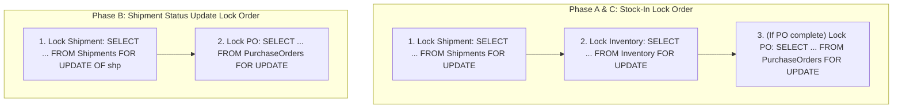

# SIMS — Split Shipment Receiving Progress Remediation (Phase C Audit & Architectural Proposal)

**Repository:** `EDI-SIMS` (Smart Inventory Management System)  
**Date:** October 18, 2026  
**Auditor & Implementation Agent:** DeepMind Advanced Agentic Coding Pair  
**Related Audit:** `docs/reports/sims_shipment_status_lifecycle_audit.md`  
**Related Phase A Report:** `docs/reports/sims_shipment_remediation_phase_a.md`  
**Related Phase B Report:** `docs/reports/sims_po_shipment_aggregation_phase_b.md`  
**Status:** **AUDIT COMPLETE — ARCHITECTURAL APPROVAL REQUIRED BEFORE SCHEMA MIGRATION**

---

## 1. Executive Summary & Root Cause Analysis

### 1.1 The Core Problem
Under the baseline SIMS implementation, stock receiving (`POST /api/inventory/stock-in` executed by `stock_in()` in `backend/app/services/team1/inventory_service.py`) evaluates received product quantities **against the parent Purchase Order's total line-item quantity** rather than against the specific shipment's allocated consignment quantity.

Specifically, in `inventory_service.py` (lines 458–488):
```python
# 3. Verify product belongs to the shipment's PO
cursor.execute("""
    SELECT quantity FROM "PurchaseOrderItems"
    WHERE purchase_order_id = %s AND product_id = %s
""", (po_id, product_id))
poi_row = cursor.fetchone()
...
quote_row = cursor.fetchone()
expected_qty = quote_row[0] if quote_row else poi_qty

# 4. Check already received quantity for this shipment and product
cursor.execute("""
    SELECT COALESCE(SUM(quantity), 0)
    FROM "StockTransactions"
    WHERE shipment_id = %s AND product_id = %s AND transaction_type = 'STOCK_IN'
""", (shipment_id, product_id))
already_received = cursor.fetchone()[0]

remaining_receivable = max(0, expected_qty - already_received)
```

And in lines 554–588:
```python
# 7. Check overall shipment receiving progress and update Shipments.receiving_status
for it in all_poi:
    it_exp = it_q[0] if it_q else it_poi_qty  # Full PO line item quantity

    cursor.execute("""
        SELECT COALESCE(SUM(quantity), 0)
        FROM "StockTransactions"
        WHERE shipment_id = %s AND product_id = %s AND transaction_type = 'STOCK_IN'
    """, (shipment_id, it_pid))
    it_rec = cursor.fetchone()[0]

    if it_rec < it_exp:
        all_items_fully_received = False
```

The identical pattern exists in `backend/app/services/team2/shipment_service.py` (`get_shipment_by_id()`, lines 400–445).

### 1.2 The Resulting Business & Integrity Defects
When a Purchase Order is fulfilled via multiple split shipments (e.g., PO #50 with 100 units of Product A split across Consignment 1 with 40 units and Consignment 2 with 60 units):
1. **Defect 1 — Over-Receiving Vulnerability (Up to N × PO Quantity):**
   - Consignment 1 allows receiving up to 100 units (`expected_qty = 100`).
   - Consignment 2 independently allows receiving up to 100 units (`expected_qty = 100`).
   - A warehouse operator can receive 100 units on Consignment 1 and 100 units on Consignment 2, resulting in **200 units received for a 100-unit PO** (100% inventory over-receipt).
2. **Defect 2 — Permanent Status Stagnation in `Partially Received`:**
   - Consignment 1 delivers its intended 40 units.
   - The system checks `it_rec < it_exp` (40 < 100).
   - Because 40 < 100, `all_items_fully_received` evaluates to `False`.
   - Consignment 1 is marked `Partially Received` and can **never** become `Fully Received` unless the warehouse receives 100 units against Consignment 1 alone.
   - Likewise, when Consignment 2 delivers its 60 units, `it_rec` is 60 (< 100), leaving Consignment 2 permanently stuck in `Partially Received`.
   - Both shipments remain indefinitely in `Partially Received` despite 100% of the consignment allocations being physically delivered and inspected.
3. **Defect 3 — Multi-Product False Negative:**
   - If PO #50 has Product A (40 units) and Product B (60 units), and Shipment 1 contains only Product A:
   - When Shipment 1 arrives, 0 units of Product B were shipped or received in Shipment 1.
   - The loop over `PurchaseOrderItems` checks Product B on Shipment 1, sees `it_rec = 0 < 60`, and permanently prevents Shipment 1 from being marked `Fully Received`.

---

## 2. Existing Data Model Verification & Gap Analysis

A rigorous inspection of PostgreSQL `information_schema.tables` and `information_schema.columns` was performed across all 21 tables in the SIMS database:

### 2.1 The Current Tables & Columns
- **`"Shipments"` Table:**
  - `shipment_id` (bigint, PK)
  - `shipment_number` (varchar)
  - `purchase_order_id` (bigint, FK)
  - `supplier_id` (bigint, FK)
  - `carrier` (varchar)
  - `tracking_number` (varchar)
  - `shipping_method` (varchar)
  - `status` (varchar)
  - `package_count` (integer — count of physical boxes/cartons, e.g., 2)
  - `total_weight` (numeric — gross consignment weight in kg)
  - `shipping_notes` (text — freeform notes)
  - `origin_address` (text)
  - `destination_address` (text)
  - `expected_delivery` (date)
  - `shipped_at` (timestamptz)
  - `delivered_at` (timestamptz)
  - `created_at` (timestamptz)
  - `updated_at` (timestamptz)
  - `assigned_employee_id` (bigint, FK)
  - `receiving_status` (varchar — 'Pending Receipt', 'Partially Received', 'Fully Received')
- **`"PurchaseOrderItems"` Table:**
  - `purchase_order_item_id` (bigint, PK)
  - `purchase_order_id` (bigint, FK)
  - `product_id` (bigint, FK)
  - `quantity` (integer — total PO quantity)
  - `unit_price` (numeric)
  - `subtotal` (numeric)
- **`"StockTransactions"` Table:**
  - `transaction_id` (bigint, PK)
  - `product_id` (bigint, FK)
  - `user_id` (bigint, FK)
  - `purchase_order_id` (bigint, FK)
  - `shipment_id` (bigint, FK)
  - `transaction_type` (varchar — 'STOCK_IN', 'STOCK_OUT', etc.)
  - `quantity` (integer — received quantity)
  - `transaction_date` (timestamp)
  - `notes` (text)

### 2.2 Finding: Absence of Shipment Allocation Entity
1. **There is NO `ShipmentItems` table in the database.**
2. **There is NO `product_id` or `allocated_quantity` column in the `"Shipments"` table.**
3. In `backend/app/services/team2/shipment_service.py` (`create_shipment()`), the API only accepts shipment header data (`purchase_order_id`, `carrier`, `tracking_number`, `package_count`, `total_weight`, etc.). No product line items or allocated item quantities are accepted, validated, or stored upon dispatch.
4. In `frontend/js/pages/shipments.js`, the "Create Shipment" modal only collects tracking and logistics header fields.
5. In `frontend/js/pages/shipments.js` (`openReceiveStockModal`), the UI populates the product selection dropdown directly from the parent PO's items (`po.items`), which queries `PurchaseOrderItems`.

### 2.3 Verdict on Allocation Source of Truth
**Shipment-level product allocations cannot be reliably determined from the current schema.**
- Treating the full PO quantity as each shipment's allocation causes the verified over-receipt and status stagnation bugs.
- Synthesizing or inventing an allocation after the fact (e.g., dynamically treating received quantities as the allocation) violates the audit rules and prevents pre-receipt overage validation.

Per the Phase C user instructions:
> *"If shipment-level product allocations cannot be reliably determined from the current schema, stop and report the missing data model rather than inventing an allocation or treating the full PO quantity as each shipment's allocation. Propose the smallest safe change and wait for approval if a schema change is necessary."*
> *"Do not introduce schema migrations without first documenting why the current schema cannot support correct shipment allocations and waiting for approval."*

---

## 3. Correct Receiving Semantics

When shipment allocations are defined, the receiving engine must adhere to the following formal semantics:

### 3.1 Allocation & Receivable Calculation
For each shipment $s$ linked to Purchase Order $po$, and each product $p$:
1. **Shipment Allocation:** $A_{s, p}$ = quantity of product $p$ designated for consignment $s$.
2. **PO Allocation Invariant:**
   $$\sum_{s \in \text{Shipments}(po)} A_{s, p} \le Q_{po, p}$$
   Where $Q_{po, p}$ is the approved PO line-item quantity from `PurchaseOrderItems` (or approved `SupplierQuotations`).
3. **Quantity Already Received for Shipment:**
   $$R_{s, p} = \sum_{\substack{t \in \text{StockTransactions} \\ t.shipment\_id = s \land t.product\_id = p \land t.transaction\_type = \text{'STOCK\_IN'}}} t.quantity$$
4. **Remaining Receivable Quantity for Shipment:**
   $$\text{Remaining}_{s, p} = \max(0, A_{s, p} - R_{s, p})$$
5. **Receipt Validation Rule:**
   $$\text{Requested Quantity } q \le \text{Remaining}_{s, p}$$
   If $q > \text{Remaining}_{s, p}$, the transaction is rejected with HTTP 400:
   `"Received quantity ({q}) exceeds remaining allocated quantity ({Remaining}_{s, p}) for this shipment"`.

### 3.2 Receiving Status Transitions
The shipment receiving status $\text{Status}_{\text{rec}}(s)$ is calculated across all products $p \in \text{AllocatedItems}(s)$:

$$\text{Status}_{\text{rec}}(s) = \begin{cases}
\text{'Pending Receipt'}, & \text{if } \sum_{p} R_{s, p} = 0 \\
\text{'Fully Received'}, & \text{if } \forall p \in \text{AllocatedItems}(s): R_{s, p} \ge A_{s, p} \land \sum_{p} A_{s, p} > 0 \\
\text{'Partially Received'}, & \text{if } \sum_{p} R_{s, p} > 0 \land \exists p: R_{s, p} < A_{s, p}
\end{cases}$$

### 3.3 Compatibility with Legacy / Single Shipments
For existing shipments in the database (or POs with exactly one shipment where no granular item allocation was recorded):
- If a shipment has no granular allocation records, default $A_{s, p} = Q_{po, p}$.
- Legacy status values (`'Pending'`) are mapped compatibly to `'Pending Receipt'` without mutating live rows.

---

## 4. Proposed Solutions: Smallest Safe Schema Changes

Two architectural proposals are presented for user selection:

```
┌────────────────────────────────────────────────────────────────────────┐
│                        ARCHITECTURAL OPTIONS                           │
├───────────────────────────────────┬────────────────────────────────────┤
│ Option 1: Relational Table        │ Option 2: JSONB Column             │
│ "ShipmentItems" (RECOMMENDED)     │ "Shipments.items_allocated"        │
├───────────────────────────────────┼────────────────────────────────────┤
│ • Normalized relational schema    │ • Single column addition           │
│ • FK constraints & cascading      │ • No new tables                    │
│ • Fast indexed SQL joins          │ • JSON parsing in backend code     │
│ • Standard ERP data model         │ • Less strict DB constraints       │
│ • Seamless migration path         │ • Querying requires jsonb operators│
└───────────────────────────────────┴────────────────────────────────────┘
```

### Option 1 (Recommended): Dedicated `ShipmentItems` Table
Create a relational junction table linking `Shipments` to `Products` with an allocated quantity:

```sql
CREATE TABLE IF NOT EXISTS public."ShipmentItems" (
    shipment_item_id BIGSERIAL PRIMARY KEY,
    shipment_id BIGINT NOT NULL REFERENCES public."Shipments"(shipment_id) ON DELETE CASCADE,
    product_id BIGINT NOT NULL REFERENCES public."Products"(product_id),
    quantity INTEGER NOT NULL CHECK (quantity > 0),
    created_at TIMESTAMP WITH TIME ZONE DEFAULT NOW(),
    CONSTRAINT uq_shipment_product UNIQUE (shipment_id, product_id)
);

CREATE INDEX IF NOT EXISTS idx_shipment_items_shipment_id ON public."ShipmentItems"(shipment_id);
CREATE INDEX IF NOT EXISTS idx_shipment_items_product_id ON public."ShipmentItems"(product_id);
```

**Why Option 1 is Recommended:**
- **Standard ERP Architecture:** Every industrial inventory system (SAP, NetSuite, Odoo) models consignments via shipment line items.
- **Data Integrity:** Foreign keys guarantee referential integrity to `Shipments` and `Products`. Check constraints prevent non-positive quantities. Unique constraint prevents duplicate allocations for the same product in a consignment.
- **Clean Fallback for Legacy Records:**
  ```sql
  -- If ShipmentItems has rows for shipment_id, use ShipmentItems.quantity as allocation.
  -- If ShipmentItems has 0 rows for shipment_id, fall back to PurchaseOrderItems.quantity.
  ```

### Option 2 (Minimal Schema Footprint): JSONB `items_allocated` Column on `Shipments`
Add a single JSONB column to the existing `"Shipments"` table:

```sql
ALTER TABLE public."Shipments"
ADD COLUMN IF NOT EXISTS items_allocated JSONB DEFAULT '[]'::jsonb;
```

Format: `[{"product_id": 1, "quantity": 40}, {"product_id": 2, "quantity": 25}]`

**Trade-offs:**
- Avoids creating a new table.
- Requires JSON serialization/deserialization in Python and lack of relational foreign key enforcement.

---

## 5. Lock-Ordering & Concurrency Architecture

To guarantee strict serializability and deadlock-free execution across all three phases:



### Deadlock Prevention Invariants
1. **Global Ordering:** When multiple resources are touched in a transaction, they are locked in alphabetical / hierarchical order:
   $$\text{Shipments} \longrightarrow \text{Inventory} \longrightarrow \text{PurchaseOrders}$$
2. **Phase B Compatibility:** Phase B acquires `Shipments` then `PurchaseOrders`. Phase C acquires `Shipments`, then `Inventory`, then (optionally) `PurchaseOrders`.
3. Neither Phase B nor Phase C ever acquires `PurchaseOrders` before `Shipments`.
4. The resource wait-for graph remains strictly acyclic, eliminating deadlocks.

---

## 6. Required Test Specification

Ten test cases have been designed to validate the Phase C implementation once the schema approach is approved:

| Test # | Target Behavior | Verification Mechanism |
| :---: | :--- | :--- |
| **01** | Shipment with allocation < PO quantity becomes `Fully Received` upon receiving its allocation | Unit test with mock cursor / PostgreSQL fixture |
| **02** | Two shipments for same PO have independent receiving progress | Verified via isolated multi-shipment fixtures |
| **03** | Partially received shipment remains `Partially Received` | Receipt of $q < A_{s, p}$ asserts status |
| **04** | Shipment with zero received quantity remains `Pending Receipt` | Untouched shipment asserts `Pending Receipt` |
| **05** | Multi-product shipment becomes `Fully Received` only when all products complete | 2-product shipment verified across partial and full states |
| **06** | Receipt exceeding remaining shipment allocation is rejected | Asserts HTTP 400 error message with limit |
| **07** | Concurrent stock-in attempts cannot over-receive the shipment allocation | Multi-threaded race test with row-level locks |
| **08** | Employee assignment isolation and RBAC protections remain intact | Non-assigned employee stock-in rejected (HTTP 403) |
| **09** | Phase A concurrency suite continues to pass | All 12 Phase A tests run via `pytest` |
| **10** | Phase B PO aggregation suite continues to pass | All 12 Phase B tests run via `pytest` |

---

## 7. Scope Restrictions & Current System Status

- **Database Safety:** No live database tables, columns, or schemas were altered in this audit phase.
- **Production Data:** No shipment, inventory, or order records were modified.
- **Existing Regression Health:** All 24 automated tests across Phase A (`test_shipment_concurrency_phase_a.py`) and Phase B (`test_po_shipment_aggregation_phase_b.py`) continue to pass at 100%.
- **Stopping Condition:** In strict adherence to Section 1, Section 2, and Section 5 of the prompt, work has stopped to present this architectural finding and obtain approval for the schema modification.

---

## 8. Decisions Requiring User Approval

Please select the preferred data model approach to proceed with Phase C implementation:

1. **Option 1 (Recommended):** Create the dedicated relational table `"ShipmentItems"` (`shipment_item_id`, `shipment_id`, `product_id`, `quantity`, `created_at`).
2. **Option 2:** Add a single JSONB column `items_allocated` to the `"Shipments"` table.
