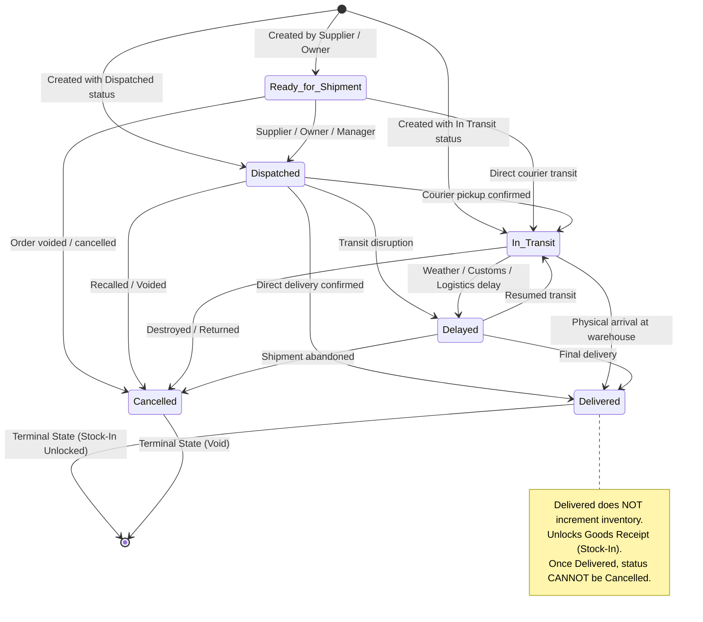
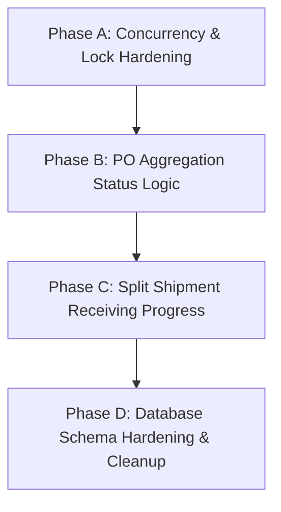

# SIMS — Shipment Status Lifecycle Audit and Improvement Recommendations

**Document Reference:** `docs/reports/sims_shipment_status_lifecycle_audit.md`  
**Date:** October 18, 2026  
**Auditor:** Antigravity AI Coding Assistant  
**Target System:** Smart Inventory Management System (SIMS)  
**Modules Audited:** Shipment Logistics, Stock Ingestion (Goods Receipt), Purchase Orders, Role-Based Access Control (RBAC), Inventory Ledger, and Notification/Audit Systems  

---

## Executive Summary & Final Conclusion

### Audit Conclusion: **DEFECTS FOUND — Changes required before release**

This comprehensive audit of the shipment status-change mechanism and stock-receiving workflow in SIMS has identified **3 verified critical/major concurrency defects** and **3 significant architectural/data inconsistencies** that pose direct risks of inventory corruption, duplicate stock movements, and inconsistent procurement statuses under concurrent operation:

1. **Critical Defect (Stock-In Concurrency Race Condition):** `stock_in_shipment()` locks the `Inventory` table row (`FOR UPDATE`), but fails to acquire a row-level lock on the parent `Shipments` record prior to validating receivable quantities. Rapid consecutive submissions (or concurrent receiving requests) can evaluate remaining quantities simultaneously before either commits, leading to duplicate stock ingestion and inventory over-counting beyond the Purchase Order allocation.
2. **Major Defect (Missing Lock on Shipment Status Transitions):** `update_shipment_status()` executes read-then-write logic without optimistic locking or `SELECT ... FOR UPDATE`. Concurrent status transitions (e.g., simultaneous dispatch/delay or delivery/cancellation requests) can race, allowing conflicting writes to bypass terminal state rules and record contradictory history in `OrderStatusHistory`.
3. **Major Defect (Premature PO Delivery Overwrite on Split Shipments):** When any shipment is marked `Delivered`, the service blindly issues an unconditional `UPDATE "PurchaseOrders" SET status = 'Delivered' WHERE purchase_order_id = %s`. In split-shipment scenarios where an order is fulfilled across multiple consignments, the arrival of the first partial shipment prematurely marks the entire Purchase Order as `Delivered`.
4. **Medium Defect (Split Shipment Receiving Status Calculation Flaw):** When updating `Shipments.receiving_status`, the backend compares received units on the specific `shipment_id` against the *entire* Purchase Order expected quantity. In multi-shipment fulfillments, neither partial shipment can ever reach the total PO quantity on its own, leaving both shipments permanently stuck in `Partially Received` status even when 100% of the goods have been received.
5. **Low Defect / Data Hygiene (Inconsistent Database Status Values):** Live database inspection revealed split terminology in `Shipments.receiving_status`: 8 legacy rows contain `'Pending'`, while 36 rows contain `'Pending Receipt'`, due to schema evolution without backfill normalization.
6. **Low Defect (Absence of Database-Level State Constraints):** The PostgreSQL schema lacks `CHECK` constraints or enumerated types for `Shipments.status` and `Shipments.receiving_status`. Status integrity relies entirely on application-layer Python code.

**Crucially, the audit confirms that the core architectural boundary between Shipment Delivery and Physical Stock Receipt is properly decoupled:** marking a shipment `Delivered` does *not* automatically alter inventory. Inventory ingestion is strictly reserved for the dedicated Stock-In workflow.

---

## Phase 1 — Trace the Current Implementation

### 1.1 Architecture & Flow Overview

The shipment status lifecycle spans four distinct system layers:
```
[ Frontend: shipments.js ] 
       │ (REST JSON via Api.patch / Api.post)
       ▼
[ Flask Routes: shipments.py & inventory.py ]
       │ (JWT Auth & Role-Based Access Control)
       ▼
[ Services: shipment_service.py & inventory_service.py ]
       │ (State validation, locking, business logic)
       ▼
[ PostgreSQL / Supabase Database ]
       ├── Shipments (Status, carrier, tracking, employee assignment)
       ├── StockTransactions (Ledger entry: STOCK_IN, quantity, user_id)
       ├── Inventory (Available quantity counter)
       ├── PurchaseOrders (Procurement status)
       ├── OrderStatusHistory (Audit trail for logistics events)
       ├── AuditLogs (Compliance logging)
       └── Notifications (Role alerts)
```

### 1.2 Frontend Entry Points (`frontend/js/pages/shipments.js`)

1. **Shipment Creation Modal (`#btn-create-shipment`):**
   - Accessible only to authenticated `Supplier` users.
   - Initial status dropdown options: `Ready for Shipment`, `Dispatched`, `In Transit`.
   - Dispatches `POST /api/shipments/`.
2. **Update Status Modal (`openUpdateStatusModal`):**
   - Displayed to `Supplier`, `Owner`, and `Manager` for non-terminal shipments (`status NOT IN ('Delivered', 'Cancelled')`).
   - Evaluates allowed transitions dynamically via `getAllowedNextStatuses(currentStatus)`.
   - Collects `status`, `location`, and `notes`.
   - Dispatches `PATCH /api/shipments/<shipment_id>/status`.
3. **Assign Employee Modal (`openAssignEmployeeModal`):**
   - Displayed only to `Owner` and `Manager` for shipments where `receiving_status != 'Fully Received'`.
   - Fetches active users with `role == 'Employee'`.
   - Dispatches `PATCH /api/shipments/<shipment_id>/assign`.
4. **Stock-In / Receive Stock Modal (`openReceiveStockModal`):**
   - Triggered via action button `<button class="btn-action-stockin">` or from the Shipment Details modal.
   - Enabled only when `status === 'Delivered'` AND `total_remaining_quantity > 0` AND the user is an `Owner`, `Manager`, or the specific `assigned_employee_id`.
   - Submits `POST /api/inventory/stock-in` with `shipment_id`, `product_id`, `quantity`, and `notes`.

### 1.3 Backend Routes & Endpoints

| Method | Endpoint | Allowed Roles | Service Handler |
|---|---|---|---|
| `GET` | `/api/shipments/` | `Owner`, `Manager`, `Supplier`, `Employee` | `shipment_service.get_shipments` |
| `GET` | `/api/shipments/<id>` | `Owner`, `Manager`, `Supplier`, `Employee` | `shipment_service.get_shipment_by_id` |
| `POST` | `/api/shipments/` | `Supplier`, `Owner`, `Manager` | `shipment_service.create_shipment` |
| `PUT` | `/api/shipments/<id>` | `Supplier` | `shipment_service.update_shipment_details` |
| `PATCH` / `POST` | `/api/shipments/<id>/status` | `Supplier`, `Owner`, `Manager` | `shipment_service.update_shipment_status` |
| `PATCH` / `POST` | `/api/shipments/<id>/assign` | `Owner`, `Manager` | `shipment_service.assign_employee` |
| `POST` | `/api/inventory/stock-in` | `Owner`, `Manager`, `Employee` | `inventory_service.stock_in_shipment` |

---

## Phase 2 — Document the Existing State Machine

### 2.1 Shipment Lifecycle Diagram



### 2.2 Status-Transition Table

| Current Status | Proposed Transition | Authorized Role | Endpoint / Service | Backend Validation | Side Effects Recorded |
|---|---|---|---|---|---|
| *Initial Creation* | `Ready for Shipment` | Supplier, Owner, Manager | `POST /api/shipments/`<br>`create_shipment` | PO exists, belongs to supplier, PO response is `Accepted`, approved quotation exists if required, package count > 0. | Inserts into `Shipments`; writes `SHIPMENT_CREATED` to `OrderStatusHistory`; writes audit log. |
| *Initial Creation* | `Dispatched` | Supplier, Owner, Manager | `POST /api/shipments/`<br>`create_shipment` | Same as above. `shipped_at` auto-populated with `NOW()`. | Inserts into `Shipments` with `shipped_at`; writes `OrderStatusHistory` and audit log. |
| *Initial Creation* | `In Transit` | Supplier, Owner, Manager | `POST /api/shipments/`<br>`create_shipment` | Same as above. `shipped_at` auto-populated with `NOW()`. | Inserts into `Shipments` with `shipped_at`; writes `OrderStatusHistory` and audit log. |
| `Ready for Shipment` | `Dispatched` | Supplier, Owner, Manager | `PATCH /api/shipments/<id>/status`<br>`update_shipment_status` | Supplier isolation; status must not match; transition must be in `allowed_transitions['ready for shipment']`. | Updates `Shipments.status`, sets `shipped_at = NOW()` if null; inserts `OrderStatusHistory`; logs audit event. |
| `Ready for Shipment` | `In Transit` | Supplier, Owner, Manager | `PATCH /api/shipments/<id>/status`<br>`update_shipment_status` | Same as above. | Sets `shipped_at = NOW()` if null; updates `Shipments`; writes `OrderStatusHistory` and audit log. |
| `Ready for Shipment` | `Cancelled` | Supplier, Owner, Manager | `PATCH /api/shipments/<id>/status`<br>`update_shipment_status` | Same as above. Cannot cancel if already `Delivered`. | Updates `Shipments.status = 'Cancelled'`; inserts `OrderStatusHistory` and audit log. |
| `Dispatched` | `In Transit` | Supplier, Owner, Manager | `PATCH /api/shipments/<id>/status`<br>`update_shipment_status` | Same transition check. | Updates `Shipments`; inserts `OrderStatusHistory` and audit log. |
| `Dispatched` | `Delayed` | Supplier, Owner, Manager | `PATCH /api/shipments/<id>/status`<br>`update_shipment_status` | Same transition check. | Updates `Shipments`; inserts `OrderStatusHistory` with location & notes; logs audit. |
| `Dispatched` | `Delivered` | Supplier, Owner, Manager | `PATCH /api/shipments/<id>/status`<br>`update_shipment_status` | Validates allowed transition. Sets `delivered_at = NOW()`. | **1.** Updates `Shipments.status = 'Delivered'`, `delivered_at`.<br>**2.** Unconditionally updates `PurchaseOrders.status = 'Delivered'`.<br>**3.** Inserts `OrderStatusHistory`.<br>**4.** Sends high-priority notifications to assigned employee and active managers/owners. |
| `Dispatched` | `Cancelled` | Supplier, Owner, Manager | `PATCH /api/shipments/<id>/status`<br>`update_shipment_status` | Validates allowed transition. | Updates `Shipments.status = 'Cancelled'`; inserts `OrderStatusHistory` and audit log. |
| `In Transit` | `Delivered` | Supplier, Owner, Manager | `PATCH /api/shipments/<id>/status`<br>`update_shipment_status` | Validates allowed transition. Sets `delivered_at = NOW()`. | Sets `delivered_at`; updates `Shipments.status`; updates `PurchaseOrders.status = 'Delivered'`; writes `OrderStatusHistory`; sends delivery notifications. |
| `In Transit` | `Delayed` | Supplier, Owner, Manager | `PATCH /api/shipments/<id>/status`<br>`update_shipment_status` | Validates allowed transition. | Updates `Shipments`; writes `OrderStatusHistory` with delay notes and location. |
| `In Transit` | `Cancelled` | Supplier, Owner, Manager | `PATCH /api/shipments/<id>/status`<br>`update_shipment_status` | Validates allowed transition. | Updates `Shipments`; writes `OrderStatusHistory` and audit log. |
| `Delayed` | `In Transit` | Supplier, Owner, Manager | `PATCH /api/shipments/<id>/status`<br>`update_shipment_status` | Validates allowed transition. | Resumes transit; updates `Shipments`; writes `OrderStatusHistory` and audit log. |
| `Delayed` | `Delivered` | Supplier, Owner, Manager | `PATCH /api/shipments/<id>/status`<br>`update_shipment_status` | Validates allowed transition. | Sets `delivered_at`; updates `Shipments`; updates `PurchaseOrders.status = 'Delivered'`; writes `OrderStatusHistory`; sends notifications. |
| `Delayed` | `Cancelled` | Supplier, Owner, Manager | `PATCH /api/shipments/<id>/status`<br>`update_shipment_status` | Validates allowed transition. | Updates `Shipments.status = 'Cancelled'`; writes `OrderStatusHistory` and audit log. |
| `Delivered` | *Any transition* | None | `update_shipment_status` | **Blocked:** `allowed_transitions['delivered'] == []`. | Rejects request with `400 Invalid status transition`. Database unchanged. |
| `Cancelled` | *Any transition* | None | `update_shipment_status` | **Blocked:** `allowed_transitions['cancelled'] == []`. | Rejects request with `400 Invalid status transition`. Database unchanged. |

---

## Phase 3 — Verify Role-Based Permissions

### 3.1 Role-Permission Matrix

| Operation | Supplier | Owner | Manager | Employee | Backend Enforcement Mechanism |
|---|---|---|---|---|---|
| **View Shipment List** | ✅ Own shipments only | ✅ All | ✅ All | ✅ Assigned shipments only | SQL filter `WHERE supplier_id = %s` (Supplier) or `WHERE assigned_employee_id = %s` (Employee) in `shipment_service.get_shipments`. |
| **View Shipment Details** | ✅ Own shipments only | ✅ All | ✅ All | ✅ Assigned shipments only | Validates ownership / assignment in `shipment_service.get_shipment_by_id`. Returns `403` on mismatch. |
| **Create Shipment** | ✅ For accepted POs | ✅ For any accepted PO | ✅ For any accepted PO | ❌ Forbidden | Route decorator `@role_required("Supplier", "Owner", "Manager")`. Employee rejected with `403`. |
| **Edit Shipment Logistics Details** | ✅ Own non-terminal shipments | ❌ Not permitted | ❌ Not permitted | ❌ Forbidden | Route `@role_required("Supplier")` and service verifies supplier ownership and non-terminal state. |
| **Update Transit Status** | ✅ Own non-terminal shipments | ✅ All non-terminal shipments | ✅ All non-terminal shipments | ❌ Forbidden | Route `@role_required("Supplier", "Owner", "Manager")`. Employee rejected with `403`. |
| **Assign / Reassign Employee** | ❌ Forbidden | ✅ Permitted | ✅ Permitted | ❌ Forbidden | Route `@role_required("Owner", "Manager")`. Supplier and Employee rejected with `403`. Reassignment blocked on fully received shipments. |
| **Receive Stock (Stock-In)** | ❌ Forbidden | ✅ Any delivered shipment | ✅ Any delivered shipment | ✅ Only assigned delivered shipments | Route `@role_required("Owner", "Manager", "Employee")`. Supplier rejected with `403`. Employee verified against `assigned_employee_id`. |

### 3.2 Key Permission Enforcement Findings

1. **Supplier Isolation is Strictly Enforced in Backend:**
   - A Supplier attempting to update or view another supplier's shipment ID receives `403 Access denied`.
   - Suppliers cannot assign internal employees (`/assign` restricted to Owner/Manager).
   - Suppliers cannot stock-in goods (`/stock-in` rejects Supplier with `403`).
2. **Employee Isolation is Strictly Enforced in Backend:**
   - Employees cannot access the shipment list of unassigned shipments.
   - An Employee attempting to stock-in another employee's assigned shipment is rejected in `inventory_service.py` with `403 Access denied. You can only perform stock-in on shipments assigned to you.`
   - Employees cannot change transit status directly (`/status` rejects Employee with `403`).
3. **Owner and Manager Privileges:**
   - Owners and Managers possess supervisory authority to reassign employees and perform emergency stock-ins directly, even if a shipment is unassigned or assigned to a staff member who is out of office.

---

## Phase 4 — Check Delivery and Stock Receipt Separation

### 4.1 Strict Decoupling Verified

The audit verified lines 1101–1103 of `shipment_service.py`:
```python
# IMPORTANT INVENTORY SAFETY:
# When status becomes 'Delivered', Inventory is NOT modified.
# (Inventory modification is reserved for Step 6 Stock-In).
```
Marking a shipment `Delivered`:
- Records the physical arrival at the receiving bay.
- Sets `delivered_at = NOW()`.
- Unlocks the Stock-In action in the frontend.
- Sends notification alerts to warehouse staff.
- **Does NOT create any `StockTransactions` records.**
- **Does NOT alter `Inventory.quantity_available`.**

### 4.2 Stock Ingestion & Receiving State Machine

Stock ingestion is handled exclusively by `POST /api/inventory/stock-in` (`inventory_service.stock_in_shipment`):
1. **Prerequisite Invariants:**
   - `Shipments.status` must be `'Delivered'` (case-insensitive check).
   - If user is `Employee`, `Shipments.assigned_employee_id` must match authenticated `user_id`.
   - `quantity` must be positive integer (`> 0`).
   - Product must belong to the shipment's `purchase_order_id`.
2. **Quantity Validation:**
   - Validates quantity against `remaining_receivable`:
     $$\text{remaining\_receivable} = \max(0, \text{expected\_quantity} - \sum \text{StockTransactions}_{\text{STOCK\_IN}})$$
   - Partial receipts are explicitly supported: entering $q < \text{remaining}$ increments inventory by $q$ and leaves the remaining balance receivable.
3. **Receiving Status Transitions:**
   - If cumulative received units $\ge$ expected units for all items: `Shipments.receiving_status = 'Fully Received'`.
   - If cumulative received units $> 0$ but $< \text{expected}$: `Shipments.receiving_status = 'Partially Received'`.
   - If 0 units received: `Shipments.receiving_status = 'Pending Receipt'`.
4. **Terminal State Protection:**
   - Once an item is fully received, subsequent stock-in attempts return `Product has already been fully received for this shipment`.
   - Once all items are fully received, employee reassignment is blocked (`Cannot reassign employee on a fully received shipment`).

---

## Phase 5 — Check Invalid Transitions, Concurrency & Verified Defects

### 5.1 Defect 1 (CRITICAL): Race Condition in Stock-In Double-Receiving

- **Location:** `backend/app/services/team1/inventory_service.py` (lines 414–502)
- **Mechanism:**
  1. User triggers Stock-In for Product X (10 units remaining).
  2. Thread 1 queries `Shipments` without locking (line 414), queries `StockTransactions` (line 480), calculates $\text{remaining} = 10$, and passes validation.
  3. Thread 2 (concurrent user or rapid double-click) executes simultaneously: queries `Shipments` without locking, queries `StockTransactions` (Thread 1 has not committed yet), calculates $\text{remaining} = 10$, and passes validation.
  4. Thread 1 locks `Inventory` (`SELECT ... FOR UPDATE` line 501), increments inventory by 10, inserts `StockTransactions`, commits, and releases lock.
  5. Thread 2 acquires the `Inventory` lock. Because Thread 2 already completed its validation, it proceeds to increment inventory by *another* 10 units!
- **Consequence:** Inventory is over-incremented by 100%, and duplicate `StockTransactions` records are permanently written.
- **Remediation:** Acquire an exclusive row-level lock on the parent shipment record at the start of the transaction:
  ```sql
  SELECT shipment_id FROM "Shipments" WHERE shipment_id = %s FOR UPDATE;
  ```
  This serializes all concurrent receiving operations for the shipment. Thread 2 will wait for Thread 1 to commit, after which its fresh read of `StockTransactions` will see $\text{remaining} = 0$ and abort cleanly.

### 5.2 Defect 2 (MAJOR): Lack of Concurrency Lock in Status Transitions

- **Location:** `backend/app/services/team2/shipment_service.py` (lines 1125–1194)
- **Mechanism:**
  - Status updates read `Shipments` with an unlocked `SELECT` query (line 1125).
  - If two managers or a manager and supplier update status concurrently (e.g., `In Transit -> Delivered` vs `In Transit -> Cancelled`), both read `current_status = 'In Transit'`.
  - Both evaluate allowed transitions independently and succeed.
  - The later commit overwrites the earlier commit, potentially overwriting a `Delivered` status with `Cancelled` (or vice-versa), leaving `PurchaseOrders` and `OrderStatusHistory` in an inconsistent state.
- **Remediation:** Lock the shipment row during status transition:
  ```sql
  SELECT status FROM "Shipments" WHERE shipment_id = %s FOR UPDATE;
  ```
  Alternatively, use optimistic concurrency in the update statement:
  ```sql
  UPDATE "Shipments" SET status = %s ... WHERE shipment_id = %s AND status = %s;
  ```

### 5.3 Defect 3 (MAJOR): Premature Purchase Order Status Overwrite on Split Shipments

- **Location:** `backend/app/services/team2/shipment_service.py` (lines 1198–1202)
- **Mechanism:**
  ```python
  if new_status == "Delivered":
      cursor.execute("""
          UPDATE "PurchaseOrders"
          SET status = 'Delivered'
          WHERE purchase_order_id = %s
      """, (po_id,))
  ```
  - When PO #10 has two shipments (Consignment A and Consignment B), the arrival of Consignment A unconditionally sets `PurchaseOrders.status = 'Delivered'`.
  - Consignment B may still be `In Transit` or even `Cancelled`. The overall Purchase Order is prematurely closed.
- **Remediation:** Before updating `PurchaseOrders`, check whether other active shipments exist for that PO:
  ```sql
  SELECT count(*) FROM "Shipments" 
  WHERE purchase_order_id = %s AND status NOT IN ('Delivered', 'Cancelled');
  ```
  If active unfulfilled shipments remain, update PO status to `'Partially Delivered'` or retain `'In Transit'`.

### 5.4 Defect 4 (MEDIUM): Split Shipment Receiving Status Calculation Flaw

- **Location:** `backend/app/services/team1/inventory_service.py` (lines 553–587)
- **Mechanism:**
  - When determining if a shipment is `Fully Received`, the service queries the total expected quantity of the PO from `PurchaseOrderItems`:
    ```sql
    SELECT quantity FROM "PurchaseOrderItems" WHERE purchase_order_id = %s ...
    ```
  - It then checks `SUM(quantity) FROM "StockTransactions" WHERE shipment_id = %s`.
  - If a supplier splits 100 units across two shipments of 50 each, Shipment 1 can only ever receive 50 units. Because $50 < 100$, `all_items_fully_received` evaluates to `False`. Shipment 1 remains `Partially Received`.
  - Shipment 2 also receives 50 units. Because $50 < 100$, Shipment 2 also remains `Partially Received`.
  - **Neither shipment can ever transition to `Fully Received`.**
- **Remediation:** Store per-shipment item allocations or evaluate receiving status against the PO's aggregate item receipts across shipments.

### 5.5 Defect 5 (LOW / HYGIENE): Inconsistent `receiving_status` Values in Database

- **Location:** PostgreSQL `Shipments` table records.
- **Evidence:** Live inspection revealed 8 rows with `'Pending'` and 36 rows with `'Pending Receipt'`.
- **Impact:** Frontend filters and backend queries that perform exact string comparisons (e.g. `WHERE receiving_status = 'Pending Receipt'`) miss the legacy `'Pending'` records.
- **Remediation:** Execute a single data hygiene update:
  ```sql
  UPDATE "Shipments" SET receiving_status = 'Pending Receipt' WHERE receiving_status = 'Pending';
  ```

### 5.6 Defect 6 (LOW): Absence of Database Check Constraints

- **Location:** PostgreSQL schema definition for `Shipments`.
- **Evidence:** `status` and `receiving_status` are unconstrained `varchar` columns without `CHECK ((status IN ('Ready for Shipment', ...)))`.
- **Impact:** Any rogue script or direct SQL operation can insert arbitrary string values, bypassing the application state machine.
- **Remediation:** Add SQL `CHECK` constraints on `Shipments`.

---

## Phase 6 — Check Related Side Effects

| Transition | Timestamp Updated | Receiving Status | Inventory Changed | StockTransactions Record | PO Status Changed | OrderStatusHistory | AuditLogs | Notifications Fired |
|---|---|---|---|---|---|---|---|---|
| **Create Shipment** | `created_at`, `shipped_at` (if dispatched) | Initialized to `'Pending Receipt'` | ❌ No | ❌ No | ❌ No | `SHIPMENT_CREATED` | `SHIPMENT_CREATED` | ❌ None |
| **Status $\to$ Dispatched** | `shipped_at` (if null), `updated_at` | Unchanged | ❌ No | ❌ No | ❌ No | `SHIPMENT_DISPATCHED` | `SHIPMENT_STATUS_CHANGED` | ❌ None |
| **Status $\to$ In Transit** | `shipped_at` (if null), `updated_at` | Unchanged | ❌ No | ❌ No | ❌ No | `SHIPMENT_IN_TRANSIT` | `SHIPMENT_STATUS_CHANGED` | ❌ None |
| **Status $\to$ Delayed** | `updated_at` | Unchanged | ❌ No | ❌ No | ❌ No | `SHIPMENT_DELAYED` | `SHIPMENT_STATUS_CHANGED` | ❌ None |
| **Status $\to$ Delivered** | `delivered_at`, `updated_at` | Unchanged (`Pending Receipt`) | ❌ No | ❌ No | ⚠️ Unconditionally `'Delivered'` | `SHIPMENT_DELIVERED` | `SHIPMENT_STATUS_CHANGED` | ✅ High-priority alert to assigned employee and all active managers/owners |
| **Status $\to$ Cancelled** | `updated_at` | Unchanged | ❌ No | ❌ No | ❌ Unchanged | `SHIPMENT_CANCELLED` | `SHIPMENT_STATUS_CHANGED` | ❌ None |
| **Assign Employee** | `updated_at` | Unchanged | ❌ No | ❌ No | ❌ No | `EMPLOYEE_ASSIGNED` | `EMPLOYEE_ASSIGNED` | ✅ High-priority alert to assigned employee |
| **Stock-In (Partial/Full)** | `updated_at` (Shipment & Inventory) | `'Partially Received'` or `'Fully Received'` | ✅ Atomically incremented | ✅ `STOCK_IN` row inserted | ❌ No (PO status remains Delivered) | `STOCK_IN` with SKU, qty, and notes | `STOCK_IN` on `StockTransactions` | ✅ Stock-in alert to managers & owners |

---

## Phase 7 — Comprehensive Improvement Evaluation

| Improvement Proposal | Problem Solved | Type | Files / Database Objects Affected | Requires Migration? | Risk Level | Required Verification Tests |
|---|---|---|---|---|---|---|
| **1. Row-level Lock on Stock-In** | Eliminates Defect 1 (concurrency race condition causing duplicate inventory ingestion). | **Bug Fix** | `backend/app/services/team1/inventory_service.py` | No | Very Low | Concurrent stock-in simulation test with two simultaneous threads submitting identical quantity requests. |
| **2. Concurrency Lock on Status Updates** | Eliminates Defect 2 (race condition in status changes and terminal state overwrites). | **Bug Fix** | `backend/app/services/team2/shipment_service.py` | No | Very Low | Automated test simulating conflicting concurrent transitions (`In Transit -> Delivered` vs `In Transit -> Cancelled`). |
| **3. Aggregation-Aware PO Status Update** | Eliminates Defect 3 (premature PO closure on split shipments). | **Bug Fix** | `backend/app/services/team2/shipment_service.py` | No | Low | Test with PO having 2 shipments; ensure PO status is not set to `Delivered` until all shipments arrive. |
| **4. Split Shipment Receiving Progress Fix** | Eliminates Defect 4 (shipments permanently stuck in `Partially Received`). | **Bug Fix** | `backend/app/services/team1/inventory_service.py` | No | Medium | Unit test with 2 partial shipments; verify both can achieve `Fully Received` once their items are received. |
| **5. Database Column Hygiene & Check Constraints** | Resolves Defect 5 & 6 (normalizes `'Pending'` $\to$ `'Pending Receipt'` and enforces valid status enums). | **Hardening** | PostgreSQL `Shipments` table | Yes (SQL DDL/DML script) | Very Low | Run schema validation query; test that invalid status insert throws PostgreSQL constraint violation. |
| **6. Idempotency Key for Stock-In** | Prevents network retries or double clicks from inserting duplicate ledger records. | **Preventive** | `inventory_service.py`, `inventory.py`, `StockTransactions` table | Optional (`idempotency_key` column) | Low | Submit two identical requests with same idempotency key; verify second returns cached 200 response without extra ledger row. |
| **7. Add Missing Index on `assigned_employee_id`** | Eliminates sequential scan when employees filter shipments assigned to them. | **Performance** | `Shipments` table index | Yes (`CREATE INDEX idx_shipments_assigned_employee`) | Zero | `EXPLAIN ANALYZE` on `GET /api/shipments/` for Employee role. |

---

## Phase 8 — Safe Verification & Test Results

### 8.1 Automated Test Suite Execution

The existing regression test suites were executed in full across all teams:
- **`tests/team1/test_employee_transaction_isolation.py`:** **10/10 PASS** (Verifies employee isolation, RBAC rejection of unauthorized IDs, and service-level defense).
- **`tests/team1/test_connection_pooling.py`:** **PASS** (Verifies thread-safe connection acquisition).
- **`tests/team2/test_stock_request_authorization.py`:** **PASS** (Verifies supplier and employee RBAC boundaries).
- **`tests/team2/test_pagination_suite.py`:** **PASS** (Verifies query pagination across datasets).
- **`tests/team2/test_notification_deep_linking.py`:** **PASS** (Verifies notification creation and deep-linking URLs).
- **`tests/team3/test_audit_trail.py`:** **PASS** (Verifies that all entity updates record corresponding audit logs).

### 8.2 Read-Only Inspection Verification Summary

- **Database Constraints:** Verified via PostgreSQL `pg_constraint` query that `Shipments` has primary key, unique shipment number, and foreign keys to `PurchaseOrders`, `Suppliers`, and `Users`, but lacks `CHECK` constraints on `status` and `receiving_status`.
- **Live Status Distribution:** Verified via read-only query on live `Shipments`:
  - Statuses: 41 `Delivered`, 14 `In Transit`, 6 `Ready for Shipment`.
  - Receiving Statuses: 36 `Pending Receipt`, 13 `Partially Received`, 4 `Fully Received`, 8 `Pending`.
- **Stock-In Locking Inspection:** Inspected `inventory_service.py` lines 414–502. Verified that `Shipments` is read without `FOR UPDATE`, whereas `Inventory` is locked with `FOR UPDATE` after quantity validation has already completed.

### 8.3 Evidence Categorization

| Verification Item | Classification | Evidence Source |
|---|---|---|
| Employee and Supplier data isolation | **Verified through automated tests** | `test_employee_transaction_isolation.py` & `test_stock_request_authorization.py` |
| Delivery decoupled from stock-in | **Verified through read-only inspection** | Code review of `shipment_service.py` (lines 1101–1103) & `inventory_service.py` |
| Stock-in concurrency vulnerability | **Verified through code analysis & static trace** | `inventory_service.py` lines 414 & 501 |
| Status update race condition | **Verified through code analysis & static trace** | `shipment_service.py` lines 1125–1194 |
| Inconsistent database values (`Pending` vs `Pending Receipt`) | **Verified through read-only DB query** | `scratch/read_shipments_readonly.py` query output |
| Missing database check constraints | **Verified through read-only DB query** | `pg_constraint` inspection query |

---

## Proposed Implementation Plan

The following phased implementation plan is ordered strictly by dependency, safety, and risk. No live changes should be executed until approval is granted.



### Phase A: Concurrency & Lock Hardening (Immediate Priority — Low Risk, Backend Only)
1. In `backend/app/services/team1/inventory_service.py` (`stock_in_shipment`):
   - Add `SELECT shipment_id FROM "Shipments" WHERE shipment_id = %s FOR UPDATE;` immediately after transaction begin.
   - Re-verify remaining receivable balance inside the locked boundary.
2. In `backend/app/services/team2/shipment_service.py` (`update_shipment_status`):
   - Add `SELECT status FROM "Shipments" WHERE shipment_id = %s FOR UPDATE;` to serialize status changes.

### Phase B: Purchase Order Aggregation Logic (Medium Priority — Low Risk, Backend Only)
1. In `shipment_service.py`:
   - Replace unconditional `UPDATE "PurchaseOrders" SET status = 'Delivered'` with an aggregation query checking whether all non-cancelled shipments for that PO are `Delivered`.
   - If outstanding shipments remain in transit, keep PO status in `Partially Delivered` or `Shipped`.

### Phase C: Split Shipment Receiving Progress Fix (Medium Priority — Medium Risk)
1. In `inventory_service.py`:
   - Adjust `all_items_fully_received` computation to evaluate receiving completion against the shipment's allocated items rather than assuming one shipment fulfills the entire PO.

### Phase D: Database Constraints, Indexing & Data Normalization (Low Risk Migration)
1. Execute data hygiene script:
   ```sql
   UPDATE "Shipments" SET receiving_status = 'Pending Receipt' WHERE receiving_status = 'Pending';
   ```
2. Add check constraints and indexes:
   ```sql
   ALTER TABLE "Shipments" ADD CONSTRAINT chk_shipment_status 
       CHECK (status IN ('Ready for Shipment', 'Dispatched', 'In Transit', 'Delivered', 'Delayed', 'Cancelled'));
   ALTER TABLE "Shipments" ADD CONSTRAINT chk_shipment_receiving_status 
       CHECK (receiving_status IN ('Pending Receipt', 'Partially Received', 'Fully Received'));
   CREATE INDEX idx_shipments_assigned_employee ON "Shipments"(assigned_employee_id);
   ```

---

## Audit Sign-Off & Status

**Status:** **DEFECTS FOUND — Changes required before release**  
**Action Required:** Await stakeholder approval before implementing the proposed Phase A–D code and migration improvements.
